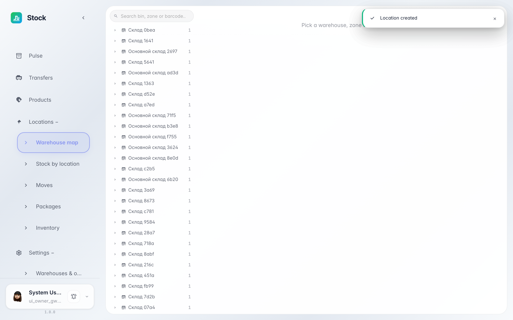
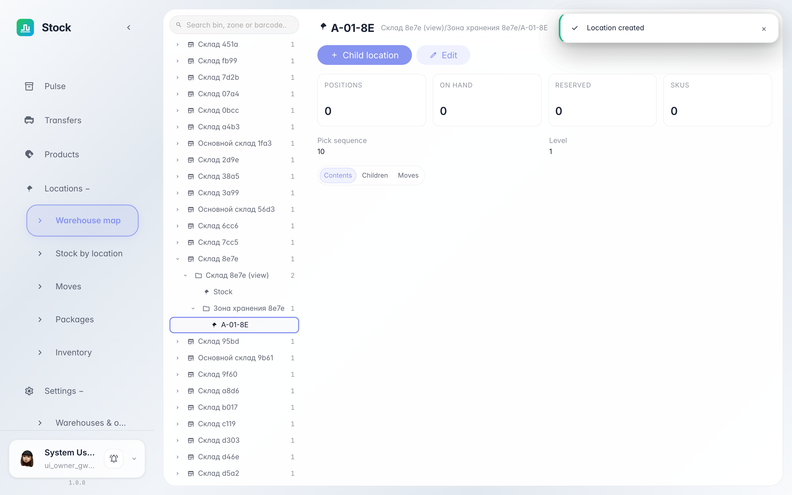

# Warehouse structure: zones and bins

**Purpose:** the warehouse map is a tree of zones, bins and containers where goods actually sit, plus the system's receiving and shipping locations.

**Problems solved:** you will see how the warehouse is split into storage addresses, what the location types mean and what each bin holds.

**Result:** the warehouse → zone → bin structure expands in the tree and the location card shows its type and stock.

## Step 1. Open the warehouse map

Choose «Locations → Warehouse map» in the left menu — the left pane is the warehouse → zones → bins → containers tree, the right pane is the selected location card. Warehouses expand by clicking the arrow next to the name.

## Step 2. Pick a bin in the tree

**Result demonstration.** Clicking a bin opens its card on the right: the full path from the warehouse, the «bin» type badge, blocking flags and KPIs — positions, quantity, reserved and SKU count. The type shows the location's role: a view groups bins (it holds no stock itself), a bin is the real stock address with a picking order, a container is a box inside a pallet. The service supplier, customer and adjustment locations are created by the system and shown in their own branch.

**Summary.** You can now see which addresses the warehouse consists of, where received goods land and what each bin holds.

