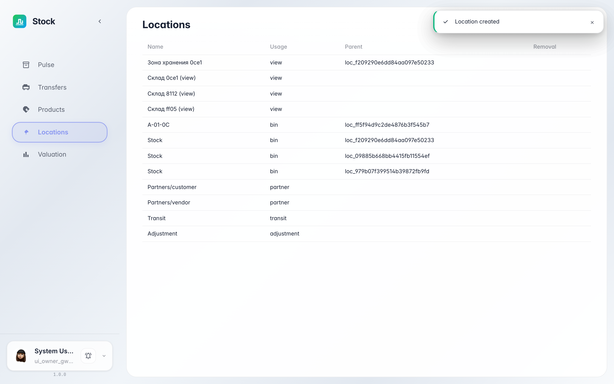

# Warehouse structure: zones and bins

**Purpose:** Locations are the warehouse map: zones, bins and containers where goods actually sit, plus the system's receiving and shipping locations.

**Problems solved:** you will see how the warehouse is split into storage addresses and what the location types mean — where put-away places goods and where picking takes them from.

**Result:** the zone → bin structure is listed among the warehouse's service locations.

## Step 1. Open Locations

Choose «Locations» in the left menu — the whole warehouse structure lives here. The Storage zone and the bin inside it are listed together: the bin's Parent column points at the zone.

## Step 2. What the location types mean

**Result demonstration.** The type shows the location's role: a view groups bins (it holds no stock itself), a bin is the real stock address with a picking order, a container is a box inside a pallet. The service supplier, customer and adjustment locations are created by the system — receipts, deliveries and corrections flow through them.

**Summary.** You can now see which addresses the warehouse consists of and where received goods land.

