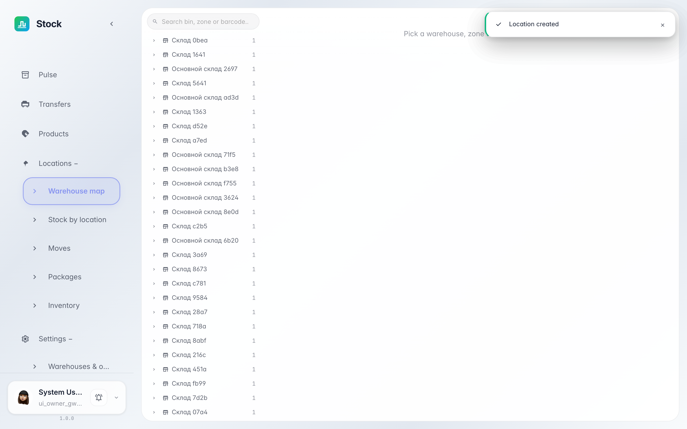
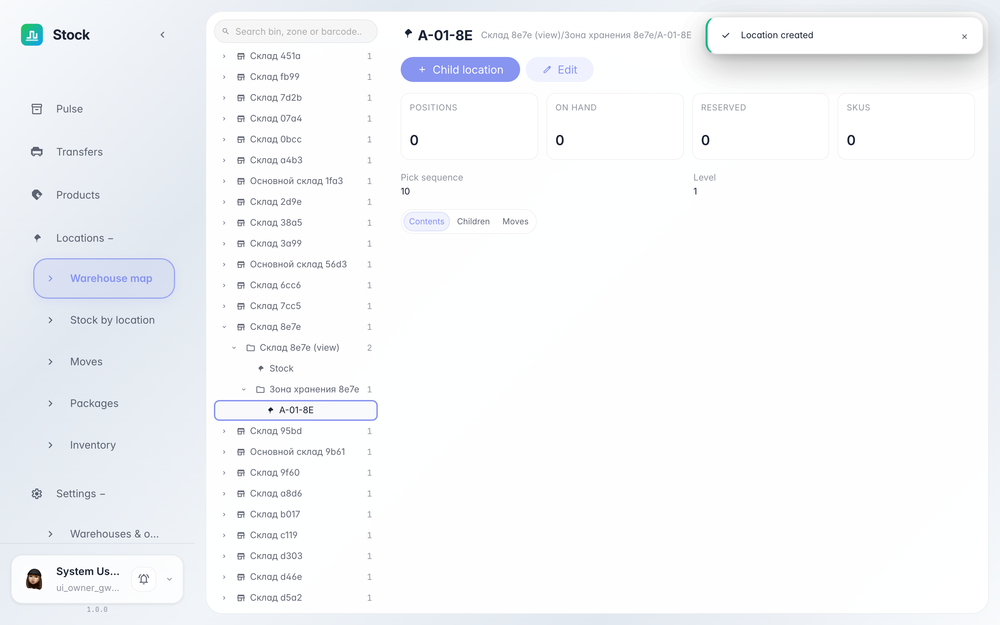

# Структура склада: зоны и ячейки

**Для чего:** «Карта склада» — это дерево склада: зоны, ячейки и тара, где реально лежит товар, плюс служебные локации приёмки и отгрузки.

**Какие проблемы решает:** вы увидите, как склад разбит на адреса хранения, что означают типы локаций и что лежит в каждой ячейке.

**Результат:** структура «склад → зона → ячейка» раскрывается в дереве, а карточка локации показывает её тип и остатки.

## Шаг 1. Откройте «Карту склада»

В меню слева выберите «Локации → Карта склада» — слева дерево «склад → зоны → ячейки → тара», справа карточка выбранной локации. Склады раскрываются кликом по стрелке рядом с именем.

## Шаг 2. Выберите ячейку в дереве

**Демонстрация результата.** Клик по ячейке открывает её карточку справа: полный путь от склада, бейдж типа «ячейка», блокировки и KPI — позиции, количество, резерв и число SKU. Тип показывает роль локации: «зона» группирует ячейки (сама товар не хранит), «ячейка» — реальный адрес запаса с порядком обхода при сборке, «тара» — короб внутри паллеты. Служебные «поставщик», «покупатель» и «перераспределение» система создаёт сама и показывает отдельной веткой.

**Итог.** Теперь вы видите, из каких адресов состоит склад, куда попадёт принятый товар и что лежит в каждой ячейке.

