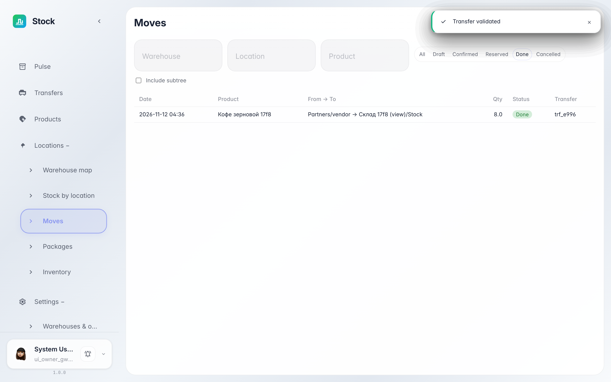
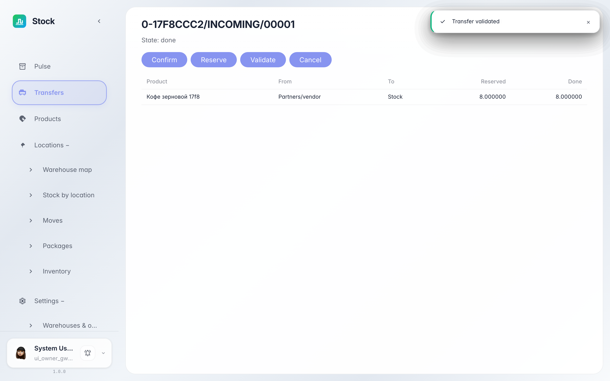

# Moves journal: every stock line under control

**Purpose:** «Moves» is the feed of every stock line: where it arrived, where it left from and in which state.

**Problems solved:** the documents journal shows a whole document, here each line stands alone — the quickest answer to «where is this product now».

**Result:** you filter moves by warehouse and state and jump to the document in one click.

## Step 1. Open Moves

In the «Locations» section choose «Moves» — each row is one goods movement: date, from and to, quantity and state. Warehouse, bin and product filters sit on top.

## Step 2. Filter validated moves

The state switcher keeps only the rows you need — e.g. «done». The badge in the State column shows each line's stage.

## Step 3. Jump to the document

The number in the last column opens the card of the document the line belongs to — a quick way to see which receipt or transfer moved the stock.

**Summary.** Moves answer «what happened to the goods» line by line, not only per document.

