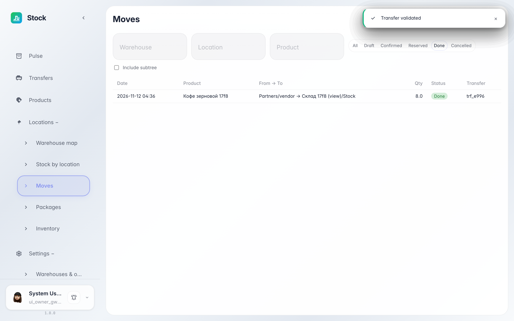
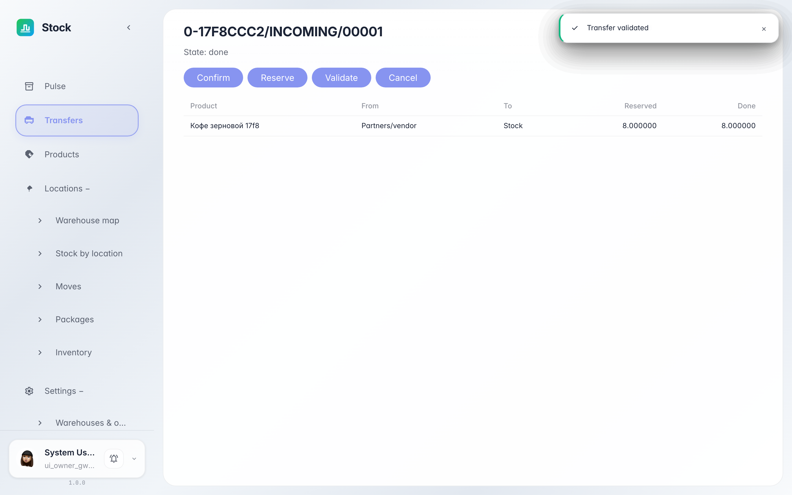

# Журнал движений: каждая строка товара под контролем

**Для чего:** «Движения» — лента всех строк товара: куда приехало, откуда уехало и в каком статусе.

**Какие проблемы решает:** журнал документов показывает документ целиком, а здесь видна каждая строка отдельно — удобно ответить «где сейчас этот товар».

**Результат:** вы фильтруете движения по складу и статусу и переходите к документу одной строкой.

## Шаг 1. Откройте «Движения»

В разделе «Локации» выберите «Движения» — каждая строка это одно перемещение товара: дата, откуда и куда, количество и статус. Сверху — фильтры по складу, ячейке и товару.

## Шаг 2. Отфильтруйте проведённые

Переключатель статусов оставляет только нужные строки — например «проведённые». Бейдж в колонке «Статус» показывает этап каждой строки.

## Шаг 3. Перейдите к документу

Номер в последней колонке открывает карточку документа, которому принадлежит строка. Так вы быстро проверяете, какой приход или перемещение двигает остаток.

**Итог.** Движения отвечают на вопрос «что происходило с товаром» по каждой строке, а не только по документу целиком.

