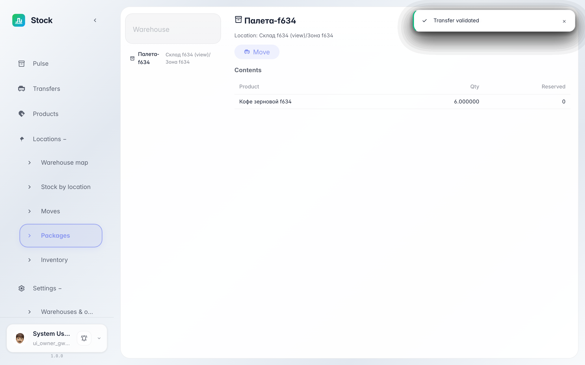
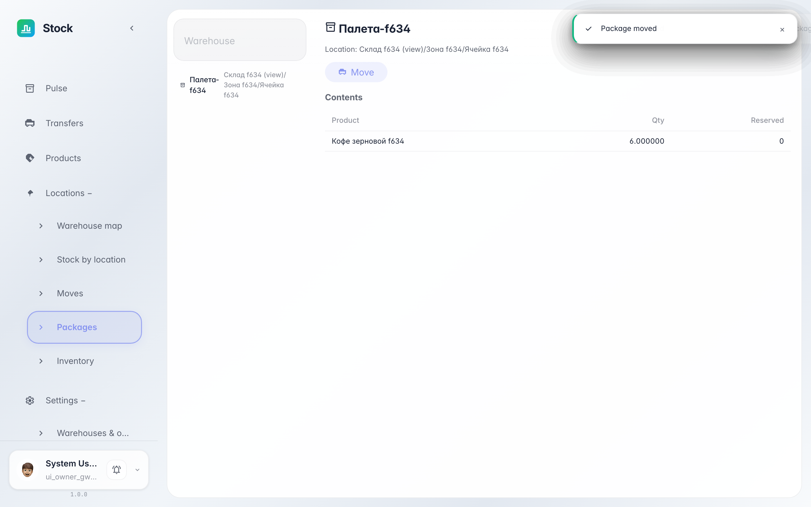

# Containers and packages: contents and moves

**Purpose:** pallets, boxes and carts are warehouse «bins» of their own. The Packages screen shows what is inside each container and where it stands.

**Problems solved:** no need to hunt goods across bins — pick a pallet and see its contents, and «Move» relocates it whole, contents included.

**Result:** you opened a pallet, checked its contents and moved it to another zone.

## Step 1. Open the pallet and check contents

The list on the left shows all containers: pallets, boxes, carts. Clicking opens the card: current location and a contents table — which goods and how much is inside.

## Step 2. Move the whole pallet

The «Move» button asks for a new spot — a zone or a bin. After confirming, the pallet and everything inside it belong to the new location: no piece-by-piece hauling needed.

**Summary.** A container is a full-fledged bin: contents are visible, and relocation takes a single action.

