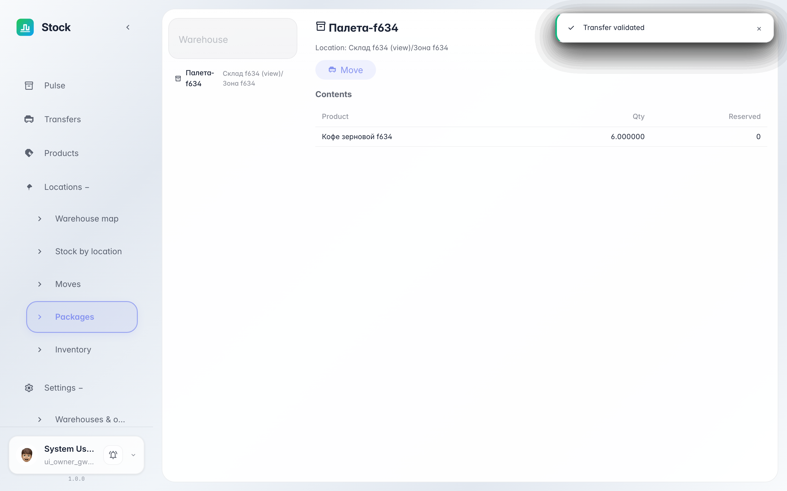
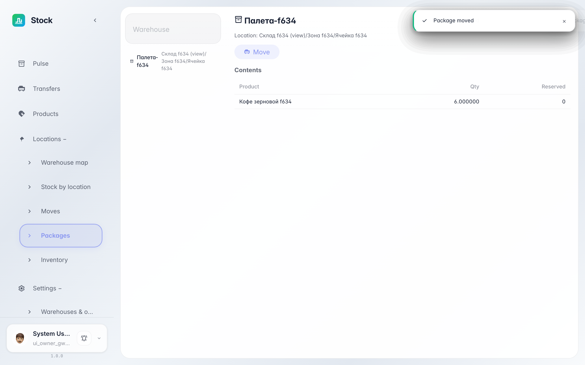

# Тара и упаковки: что внутри и куда её везти

**Для чего:** палеты, короба и тележки — отдельные «ячейки» склада. Экран «Упаковки» показывает, что лежит в каждой таре и где она стоит.

**Какие проблемы решает:** не нужно искать товар по ячейкам — выбираете палету и видите её содержимое, а кнопка «Переместить» перевозит её целиком вместе со всем внутри.

**Результат:** вы открыли палету, проверили содержимое и переместили её в другую зону.

## Шаг 1. Откройте палету и проверьте содержимое

Слева — список всей тары: палеты, короба, тележки. Клик открывает карточку: текущее место и таблица содержимого — какой товар и сколько внутри.

## Шаг 2. Переместите палету целиком

Кнопка «Переместить» предлагает выбрать новое место — зону или ячейку. После подтверждения палета и всё её содержимое числятся уже там: тащить товар поштучно не нужно.

**Итог.** Тара — полноценная ячейка: содержимое видно, а перемещение оформляется одним действием.

