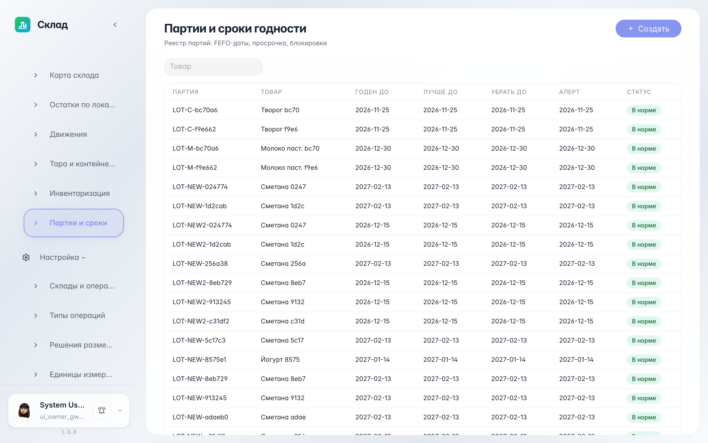
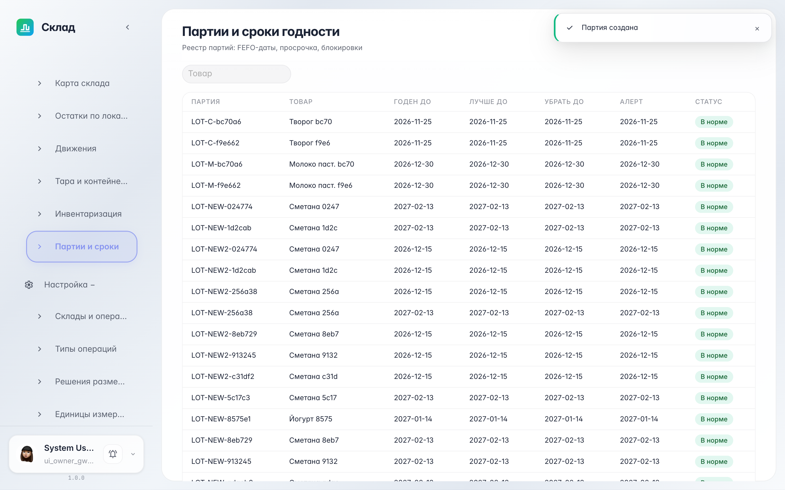

# Lots and expiry: the warehouse FEFO board

**Purpose:** a dispatcher must see which lots expire soon to speed up their shipment or write-off — before the date passes.

**Problems solved:** the «Lots» page gathers every warehouse lot into a table with «best before», «use by», «remove by» dates and a colour FEFO badge — expired ones are highlighted, a product filter narrows the view.

**Result:** two lots visible with dates and badges, a new lot registered through the form without a handheld.

## Step 1. Open «Lots» — dates and FEFO badges

«Locations → Lots»: each lot shows «best before», derived dates and a colour badge — «expiring soon» in amber, «expired» in red. The filter above narrows the list to one product.

## Step 2. Register a lot through the form

**Result demonstration.** «Create» opens the lot form: product, number and «best before». The new row appears in the table with a badge — the lot is available to receiving and picking.

**Summary.** «Lots» is the warehouse expiry board: product filter, FEFO badges and lot registration without a handheld.

