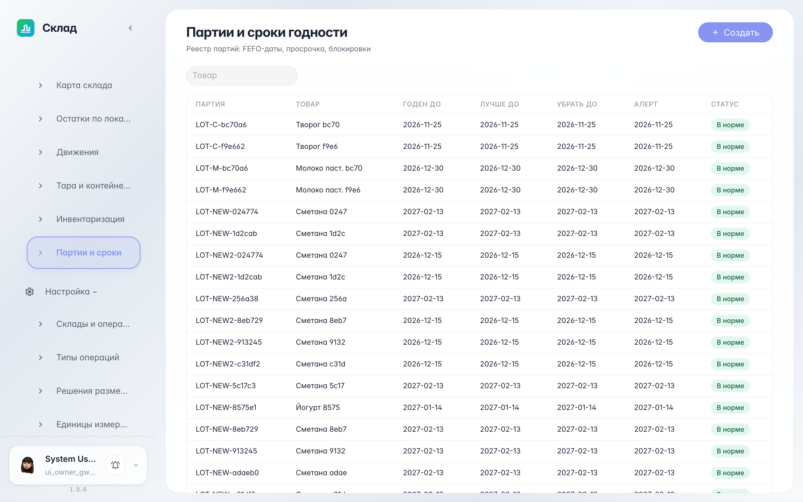
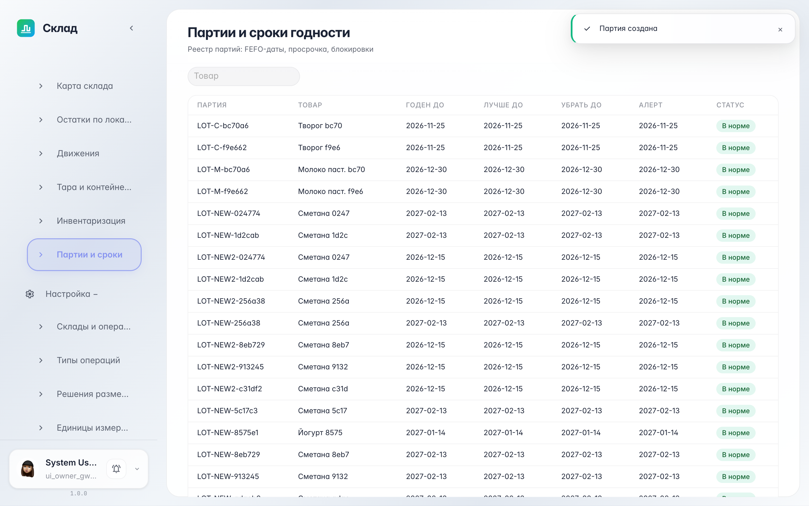

# Партии и сроки годности: FEFO-карта склада

**Для чего:** диспетчер должен видеть, какие партии скоро испортятся, чтобы ускорить их отгрузку или списание — до того как срок выйдет.

**Какие проблемы решает:** страница «Партии» собирает все партии склада в таблицу со сроками «годен до», «лучше до», «отобрать до» и цветным статусом FEFO — просроченные подсвечены, фильтр по товару сужает обзор.

**Результат:** две партии видны со сроками и статусами, новая партия заведена через форму без терминала.

## Шаг 1. Откройте «Партии» — сроки и статусы FEFO

Раздел «Локации → Партии»: каждая партия показывает «годен до», производные даты и цветной статус — «скоро истекает» жёлтым, «просрочена» красным. Фильтр сверху сужает список до одного товара.

## Шаг 2. Заведите партию через форму

**Демонстрация результата.** Кнопка «Создать» открывает форму партии: товар, номер и «годен до». Новая строка появляется в таблице со статусом — партия доступна приёмке и отбору.

**Итог.** «Партии» — карта сроков склада: фильтр по товару, статусы FEFO и заведение партий без терминала.

