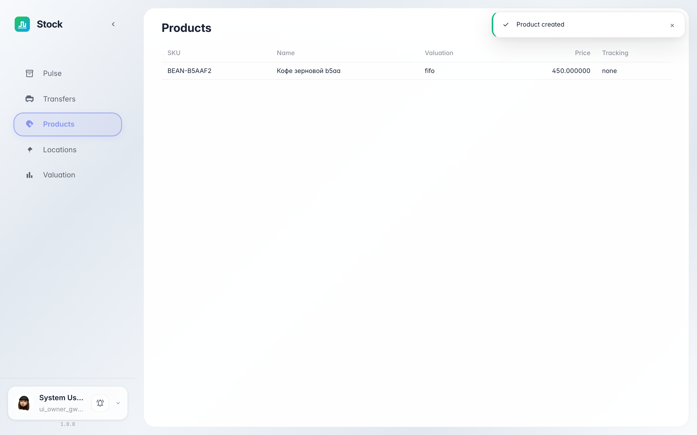

# Catalog: warehouse products

**Purpose:** the Catalog is the warehouse product book: SKU, name, valuation method and the lot-tracking rule.

**Problems solved:** you will understand what each product shows — how the warehouse costs the on-hand value (FIFO or standard price) and whether the product tracks lots or expiry dates.

**Result:** the product is listed in the catalog with its SKU, price and valuation method.

## Step 1. Open the Catalog

Choose «Catalog» in the left menu — it lists every warehouse product. The new product appears at once: SKU, name, valuation method, standard price and lot tracking.

## Step 2. What the columns mean

**Result demonstration.** Valuation method decides how on-hand cost is computed: FIFO consumes batches oldest to newest, standard price fixes the cost on the card. Tracking shows whether the product is kept by lots or serials — for expiry dates and warranties.

**Summary.** You can now read a product row in the catalog and understand how its stock is valued.

