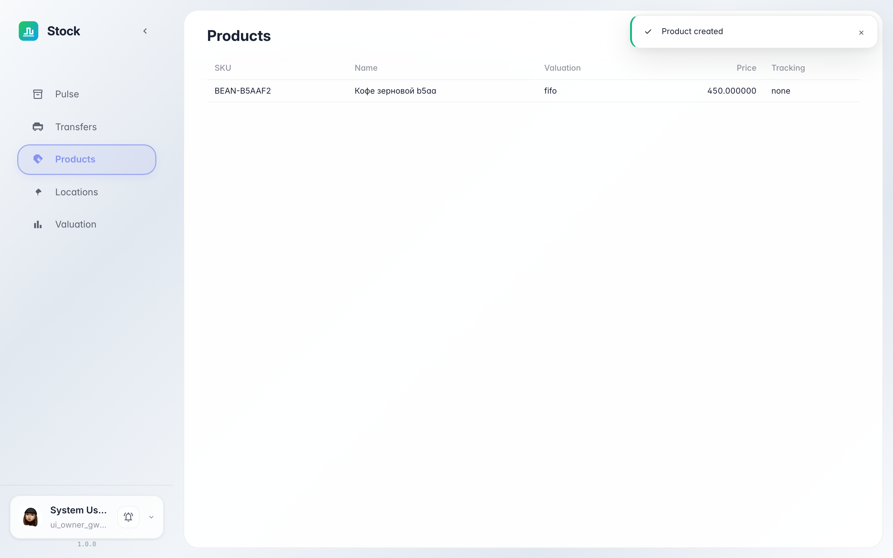

# Номенклатура: товары склада

**Для чего:** «Номенклатура» — справочник товаров склада: артикул, название, метод оценки стоимости и правило учёта партий.

**Какие проблемы решает:** вы поймёте, что видно по каждому товару — как склад считает стоимость остатка (FIFO или стандартная цена) и ведёт ли товар серии или сроки годности.

**Результат:** товар виден в номенклатуре с артикулом, ценой и методом оценки.

## Шаг 1. Откройте «Номенклатуру»

В меню слева выберите «Номенклатура» — это список всех товаров склада. Новый товар виден сразу: артикул, название, метод оценки, стандартная цена и учёт партий.

## Шаг 2. Что означают колонки

**Демонстрация результата.** «Метод оценки» решает, как считать стоимость остатка: FIFO списывает партии от старой к новой, стандартная цена фиксирует стоимость карточкой. «Учёт» показывает, ведётся ли товар по партиям или сериям — для сроков годности и гарантий.

**Итог.** Теперь вы читаете карточку товара в номенклатуре и понимаете, как склад оценивает его остаток.

