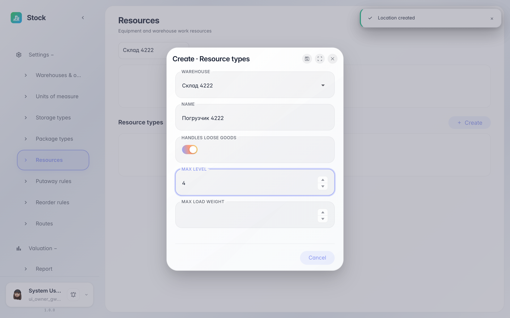
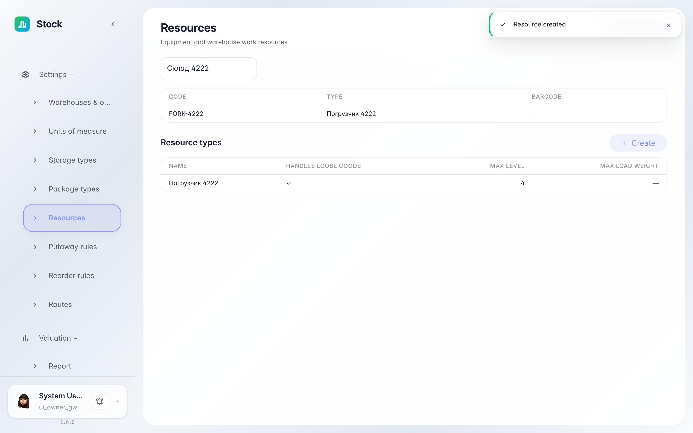
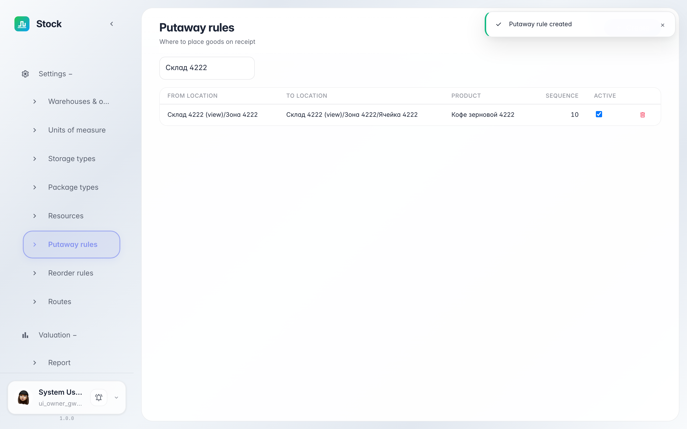
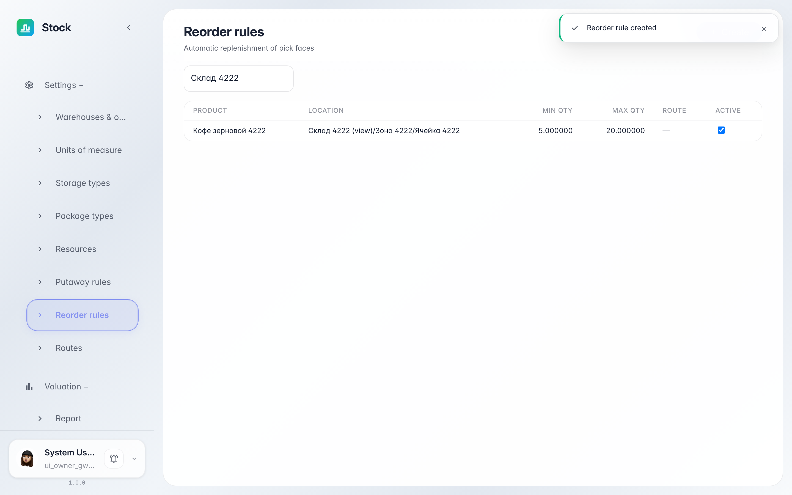
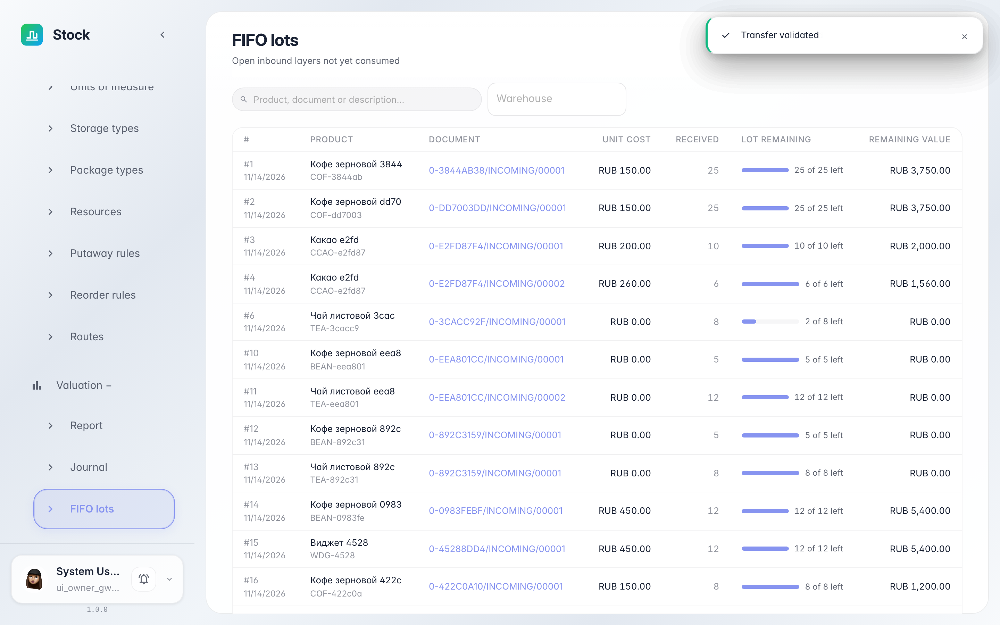
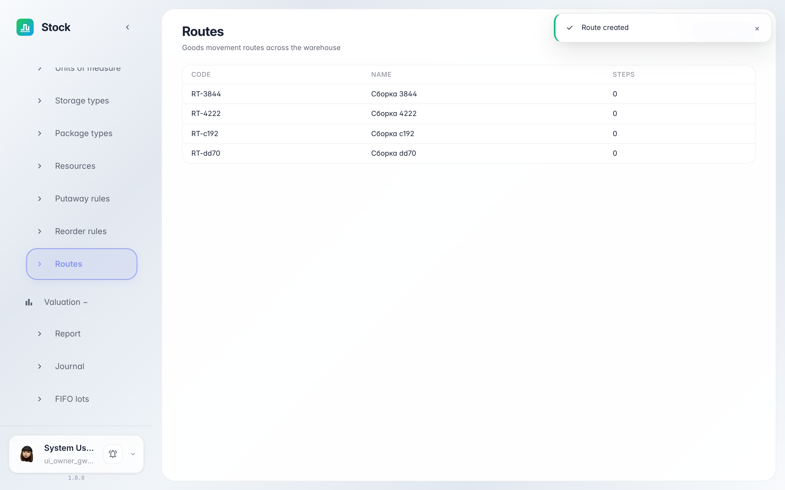

# Catalogs: equipment, putaway and reorder rules, routes

**Purpose:** the «Settings» section holds the working directories: equipment units (forklifts, carts), «where to store» putaway rules, «when to refill» reorder rules, and route types.

**Problems solved:** without equipment the scanner cannot dispatch a forklift task, without putaway rules the system cannot suggest a storage bin, and without reorder rules the pick zone silently runs dry.

**Result:** an equipment type and a forklift are registered, bins get a putaway rule, the product gets a reorder rule, and a route type is created.

## Step 1. Describe the equipment kind

In «Settings → Resources» the bottom section is «Resource types». «Create» describes the equipment: name, how many load levels it lifts and the weight limit.

## Step 2. Register an equipment unit

The header «Create» button registers a concrete unit: code, its type from the bottom section and a barcode for scanner pairing. The forklift can now be assigned to tasks.

## Step 3. Assign a putaway rule

«Settings → Putaway rules» answers «where does incoming stock go»: from the receiving zone into a concrete storage bin. «Sequence» decides which rule fires first.

## Step 4. Set the min and max stock

«Reorder rules» watch the bin: below the minimum the system suggests a replenishment up to the maximum. Pick the warehouse in the filter bar first — its operation types appear in the form.

## Step 5. Check the stock layer

«Valuation → Batches» lists each receipt as its own row: how much arrived, at what price and what is left. The receipt just posted is right there — the layer that FIFO consumes first.

## Step 6. Create a route type

«Routes» describe an order's path across warehouses — e.g. «picking → checking → shipping». The type gets a name and a code here; steps are added on the route card.

**Summary.** The warehouse directories are ready: equipment is taskable, putaway and reorder work by rules, and the route type awaits its steps.

