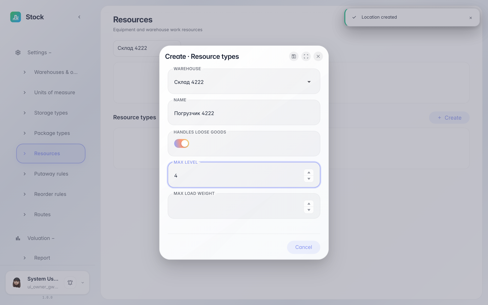
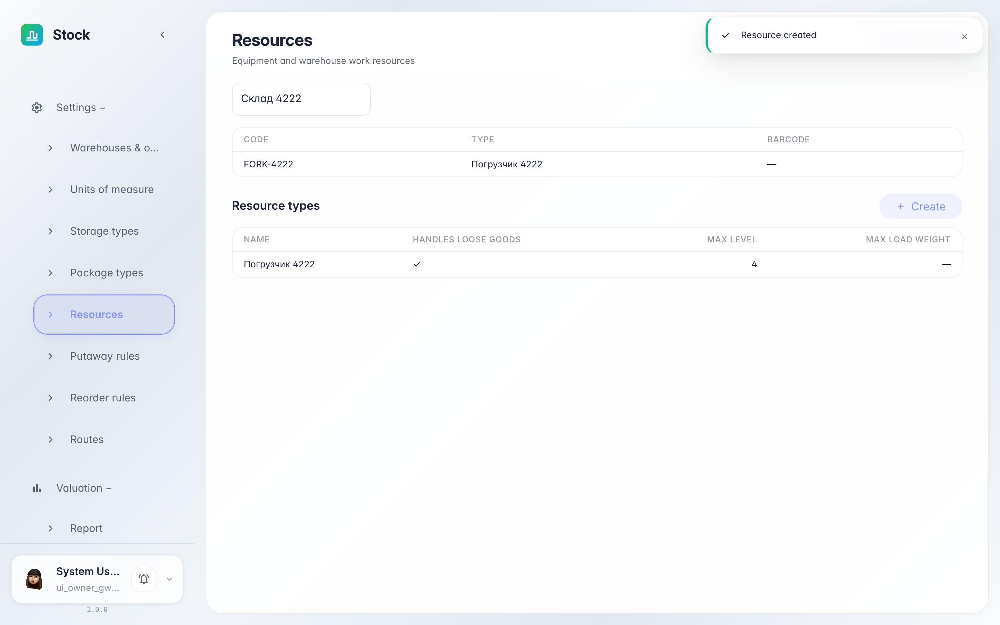
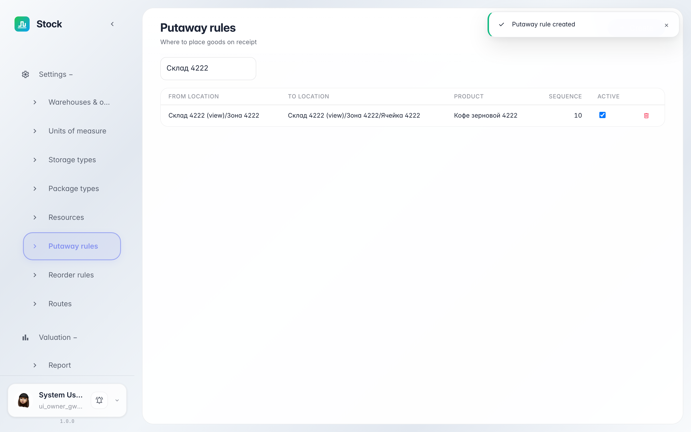
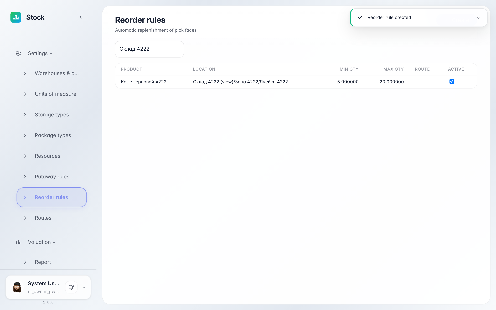
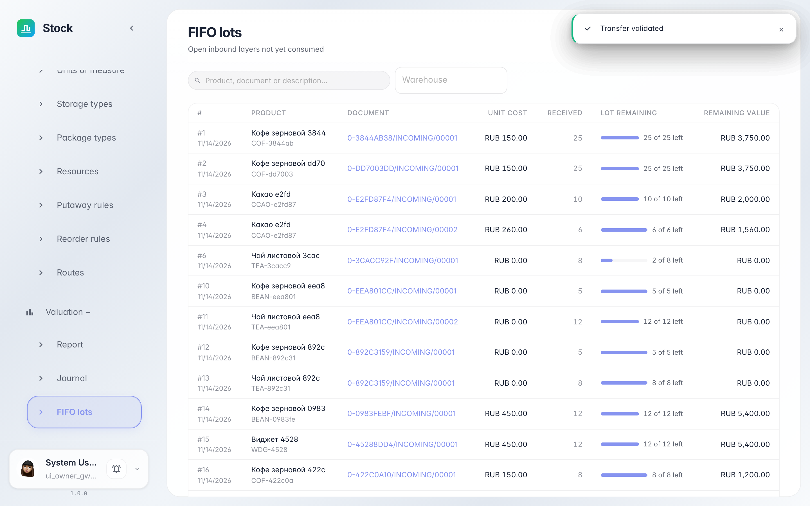
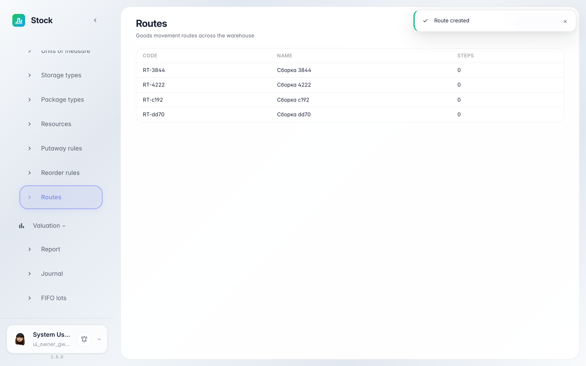

# Справочники: техника, правила размещения и маршруты

**Для чего:** в «Настройках» живут рабочие справочники склада: единицы техники (погрузчики, тележки), правила «куда класть товар» и «когда пополнять», а также типы маршрутов.

**Какие проблемы решает:** без техники ТСД не выдаст задание на погрузчик, без правил размещения система не подскажет ячейку хранения, а без правил пополнения зона отбора пустеет незаметно.

**Результат:** заведён тип техники и сам погрузчик, ячейкам назначено правило размещения, товару — правило пополнения, создан тип маршрута.

## Шаг 1. Опишите вид техники

В «Настройки → Ресурсы» нижняя секция — «Типы ресурсов». «Создать» задаёт, что это за техника: название, сколько уровней груза поднимает и предельный вес.

## Шаг 2. Заведите единицу техники

Кнопка «Создать» в шапке добавляет конкретную единицу: код, тип из нижней секции и штрихкод для привязки к ТСД. Теперь погрузчик можно указывать в заданиях.

## Шаг 3. Назначьте правило размещения

«Настройки → Правила размещения» отвечают на вопрос «куда убрать приехавший товар»: из зоны приёмки — в конкретную ячейку хранения. Порядок «Sequence» решает, какое правило срабатывает первым.

## Шаг 4. Задайте минимум и максимум запаса

«Правила пополнения» следят за ячейкой: упало ниже минимума — система предложит документ пополнения до максимума. Сначала выберите склад в панели фильтра — тогда в форме появятся его виды операций.

## Шаг 5. Проверьте партию запаса

«Оценка → Партии» показывает каждую приёмку отдельной строкой: сколько пришло, по какой цене и сколько осталось. Только что проведённый приход виден сразу — это и есть слой, который уйдёт первым по FIFO.

## Шаг 6. Создайте тип маршрута

«Маршруты» описывают путь заказа по складам — например «комплектация → проверка → отгрузка». Здесь задаётся название и код типа, шаги добавляются в карточке маршрута.

**Итог.** Справочники склада заведены: техника готова к заданиям, размещение и пополнение работают по правилам, тип маршрута ждёт своих шагов.

