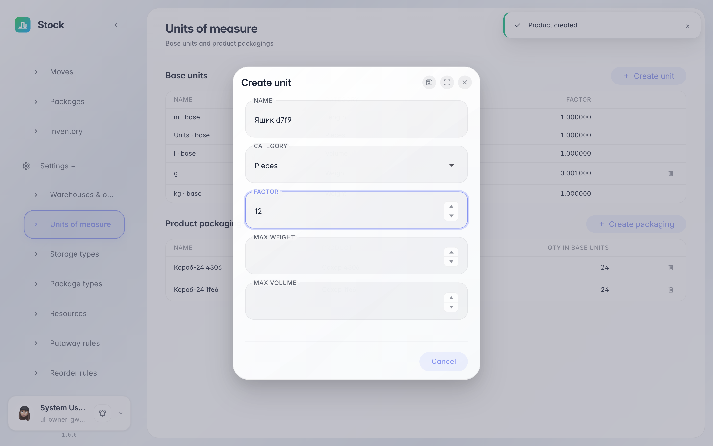
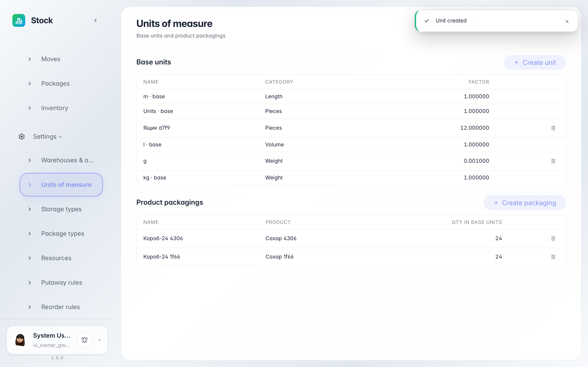
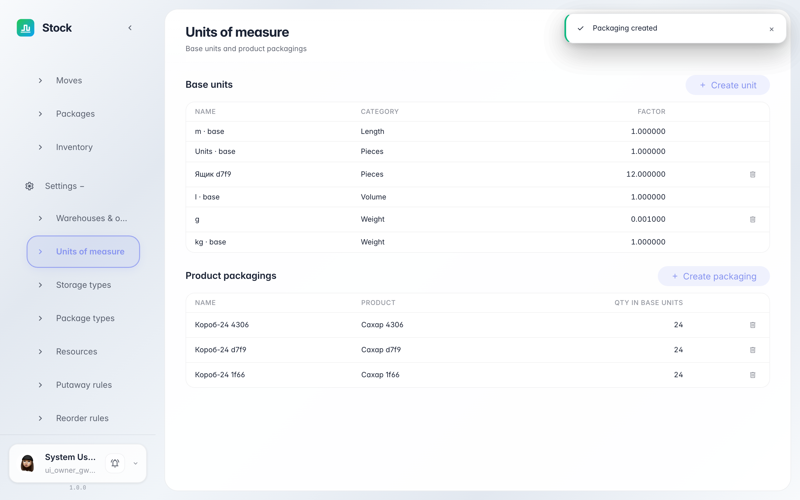
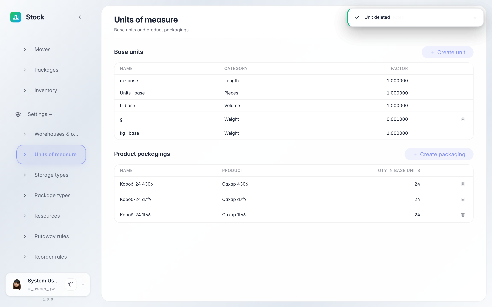

# Units of measure and packagings

**Purpose:** the «Units of measure» section maintains two directories: company base UoMs (units, kilograms, custom «crates») and product packagings («box of 24» with its own barcode).

**Problems solved:** a product cannot be registered without a UoM, and the mobile scanner cannot decode a full-box barcode without a packaging.

**Result:** a custom UoM is created, a packaging is bound to the product, the spare UoM is deleted — the directory matches real warehouse measures.

## Step 1. Create a custom unit of measure

In «Settings → Units of measure» click «Create» next to «Base UoMs»: name, category and the factor to base. A crate ×12 means «one crate equals twelve units».

## Step 2. The UoM appears in the directory

The new UoM is in the base table right away — it can be assigned as a product base unit. System «Units», «kg», «m» are marked reference and cannot be deleted.

## Step 3. Bind a packaging to the product

In the «Packagings» section pick the product, the packaging name and how many base units it holds. Scanning such a packaging on the mobile counts as «24 units» — no piece-by-piece counting.

## Step 4. Delete the spare UoM

A custom UoM is deleted via the trash icon with confirmation — as long as no product uses it as base. Packagings are deleted the same way in their section.

**Summary.** Warehouse measures are fully described: base UoMs for products, packagings for fast scanning.

