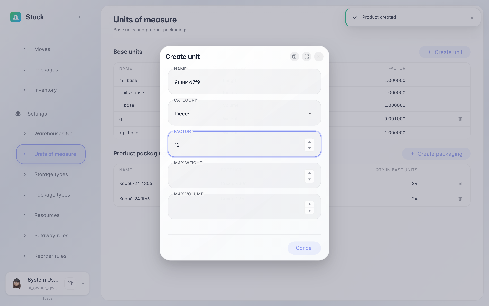
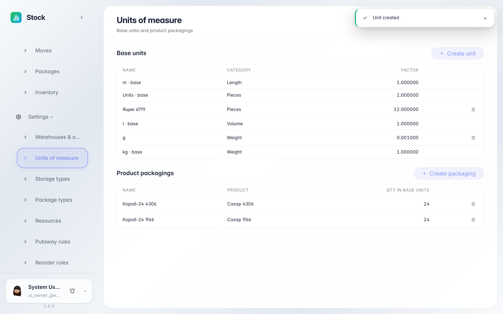
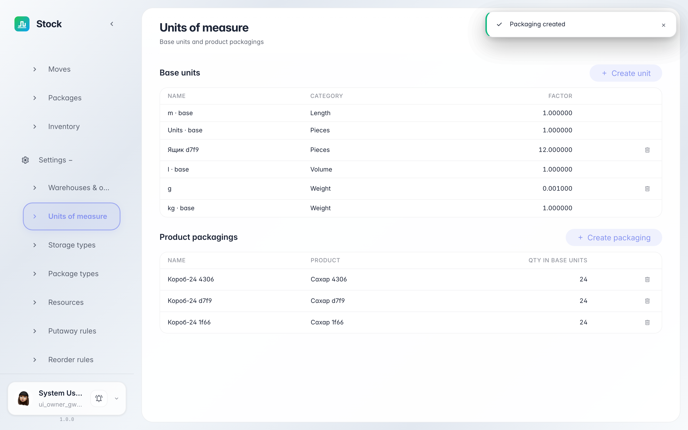
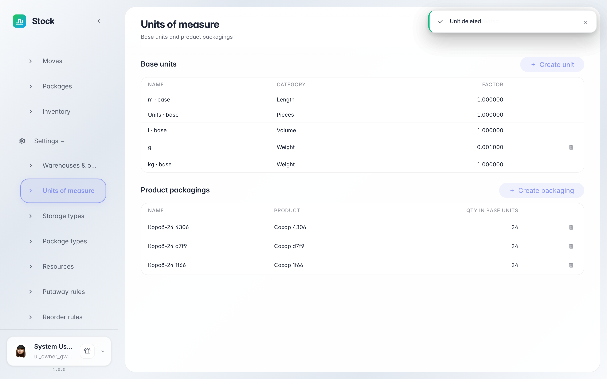

# Единицы измерения и упаковки

**Для чего:** раздел «Единицы измерения» ведёт два справочника: базовые ЕИ компании (штуки, килограммы, свои «ящики») и упаковки товаров («короб 24 шт» со своим штрихкодом).

**Какие проблемы решает:** без ЕИ товар не завести, а без упаковки ТСД не поймёт скан кода целого короба.

**Результат:** создана своя ЕИ, к товару привязана упаковка, лишняя ЕИ удалена — справочник соответствует реальным меркам склада.

## Шаг 1. Создайте свою единицу измерения

В «Настройки → Единицы измерения» нажмите «Создать» рядом с «Базовые ЕИ»: имя, категория и коэффициент к базе. Ящик ×12 означает «один ящик — это 12 штук».

## Шаг 2. ЕИ появилась в справочнике

Новая ЕИ сразу в таблице базовых — её можно назначать товарам базовой единицей. Системные «Units», «kg», «m» помечены как эталонные и не удаляются.

## Шаг 3. Привяжите упаковку к товару

В секции «Упаковки» выберите товар, имя упаковки и количество базовых ЕИ внутри. Скан такой упаковки на ТСД считается как «24 штуки» — считать поштучно не нужно.

## Шаг 4. Удалите лишнюю ЕИ

Своя ЕИ удаляется корзиной с подтверждением — пока она не стала базовой у товара. Упаковки удаляются так же из своей секции.

**Итог.** Мерки склада описаны полностью: базовые ЕИ для товаров, упаковки — для быстрого скана.

