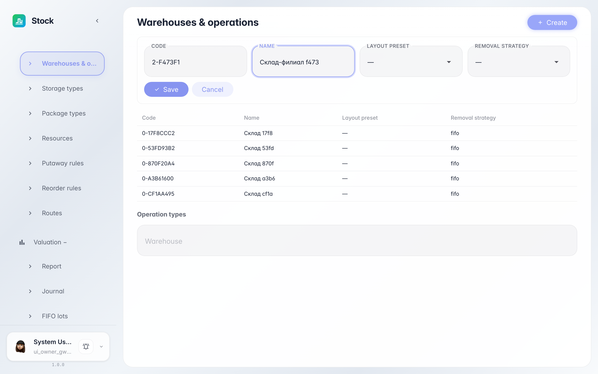
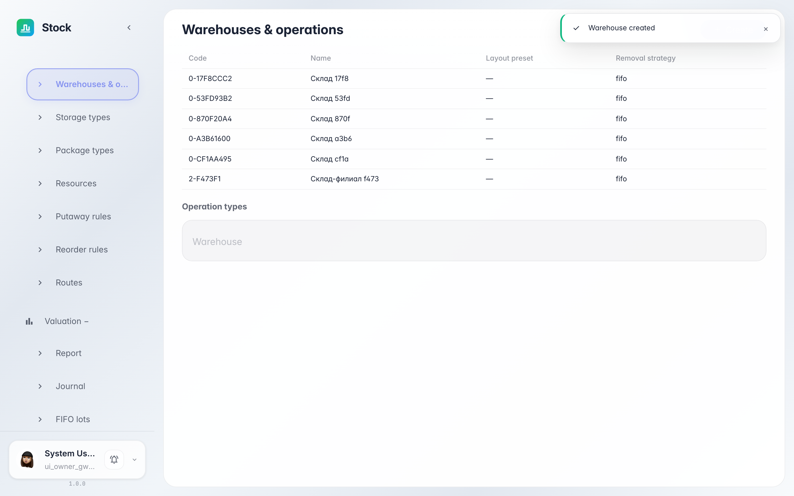
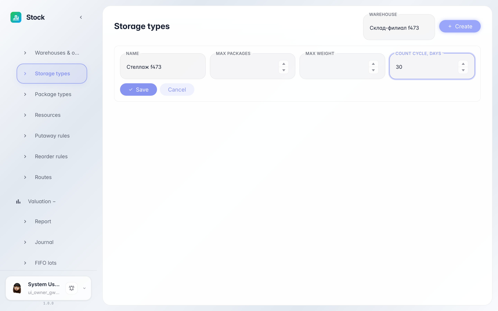
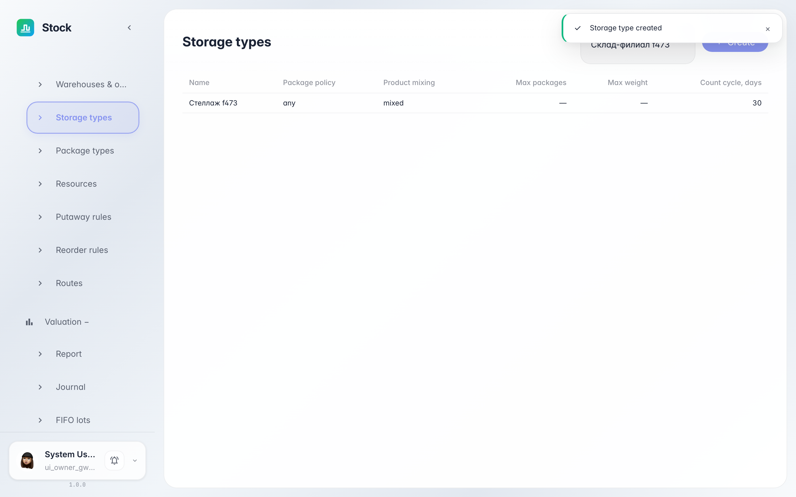

# Warehouse settings: warehouses, storage and container types

**Purpose:** the «Settings» section holds warehouse references: the warehouses themselves, bin storage types and container kinds.

**Problems solved:** a new warehouse or a new pallet kind is registered here — bins and containers of the right kind cannot be created without it.

**Result:** you registered a warehouse and a storage type via the settings forms.

## Step 1. Register a new warehouse

In «Settings → Warehouses» click «Create» and fill in code and name. Layout preset and removal strategy (FIFO/FEFO/LIFO) come with sensible defaults — adjust if needed.

## Step 2. Warehouse appears in the directory

The new warehouse is in the table right away — with its code, layout and strategy. Below on the same page the operation types of the selected warehouse are shown: receipt, delivery, internal moves.

## Step 3. Create a storage type

«Settings → Storage types» define bin rules: container limit, weight and the count interval in days — it decides when the bin lands on the inventory list. Pick a warehouse, click «Create» and fill the form.

## Step 4. Storage type is ready

The type appears in the warehouse table — now it can be assigned to bins. Container kinds, warehouse resources, putaway and reorder rules are configured the same way in the neighbouring settings sections.

**Summary.** Warehouse references live in one place: the warehouse is created and its bin rules are set.

