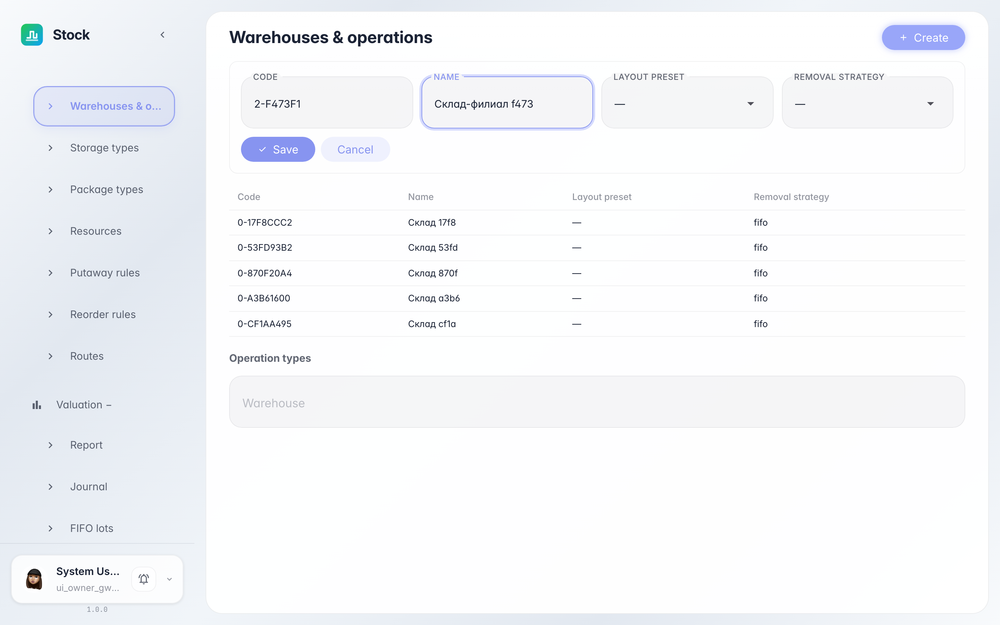
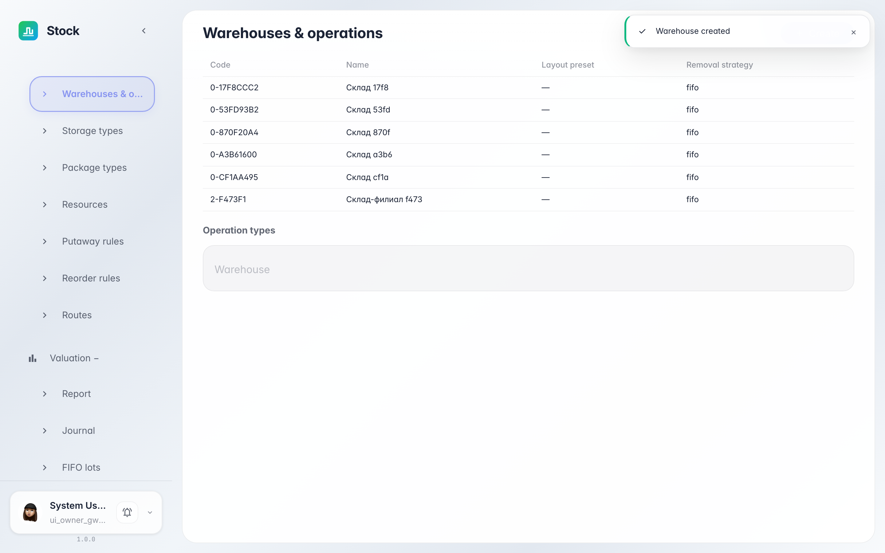
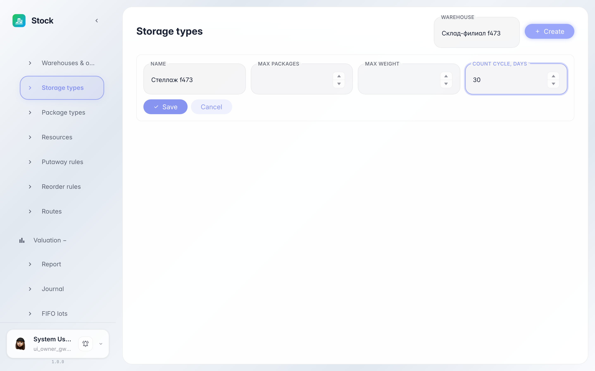
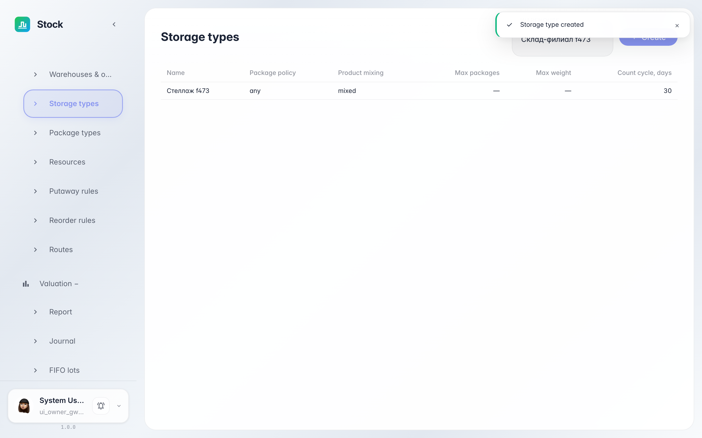

# Настройки склада: склады, типы хранения, тара

**Для чего:** раздел «Настройки» держит справочники склада: сами склады, типы хранения ячеек и виды тары.

**Какие проблемы решает:** новый склад или новый вид палеты заводится здесь — без него не создать ячейки и тару нужного вида.

**Результат:** вы завели склад и тип хранения через формы настроек.

## Шаг 1. Заведите новый склад

В «Настройки → Склады» нажмите «Создать» и заполните код и название. Схема склада (layout) и стратегия списания (FIFO/FEFO/LIFO) уже подобраны разумными значениями — меняйте при необходимости.

## Шаг 2. Склад появился в справочнике

Новый склад сразу в таблице — с кодом, схемой и стратегией. Ниже на этой же странице для выбранного склада видны типы операций: приход, отгрузка, внутренние перемещения.

## Шаг 3. Создайте тип хранения

«Настройки → Типы хранения» задают правила ячейки: лимит тары, вес и интервал пересчёта в днях — он решает, когда ячейка попадёт в инвентаризацию. Выберите склад, нажмите «Создать» и заполните форму.

## Шаг 4. Тип хранения готов к работе

Тип появился в таблице склада — теперь его можно назначать ячейкам. Так же настраиваются виды тары, ресурсы склада, правила размещения и пополнения в соседних разделах настроек.

**Итог.** Справочники склада ведутся в одном месте: склад создан, правила его ячеек заданы.

