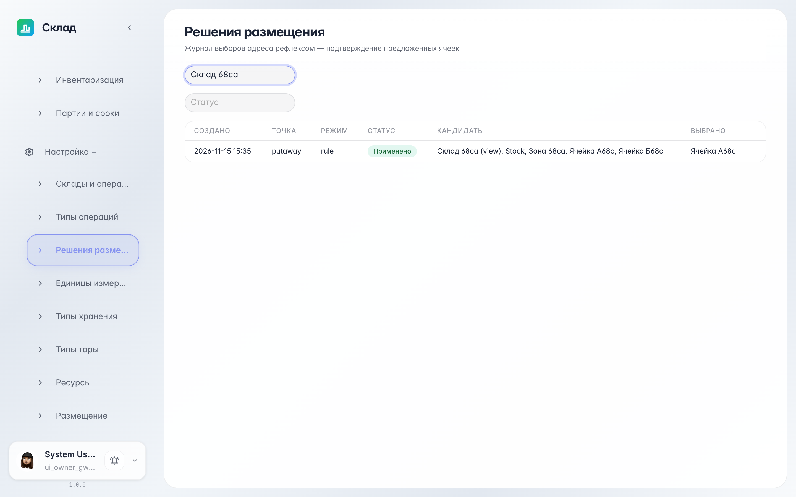
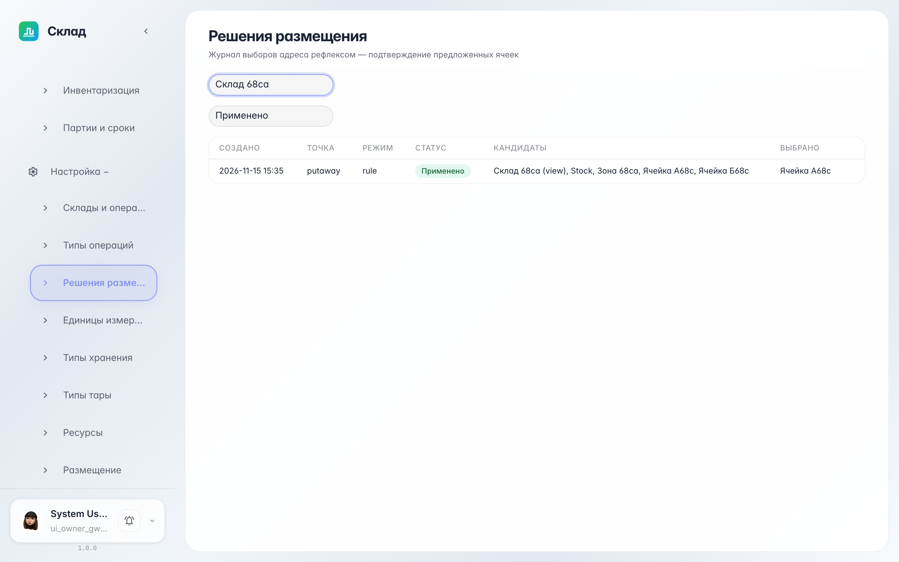

# Reflex decisions: putaway choice audit

**Purpose:** whenever the system or a dispatcher chooses a product's bin, the choice is recorded as a decision — by whom, when and from which candidates.

**Problems solved:** the «Decisions» page is the putaway audit log: reflex point, mode, candidates and the final choice; the status filter separates applied from suggested and rejected.

**Result:** the receipt's putaway decision is visible in the log as «applied» with the chosen bin.

## Step 1. Open the reflex decision log

«Settings → Decisions»: each decision is an automation point (putaway), a mode (rule, inline, shadow), candidate bins and the final choice. «Applied» status means the choice is already executed on stock.

## Step 2. Filter decisions by status

**Result demonstration.** The status filter keeps applied decisions — the log honestly shows the bin-A choice recorded and executed.

**Summary.** «Decisions» is the putaway audit: who chose which bin and why is read from the log, not from staff interviews.

