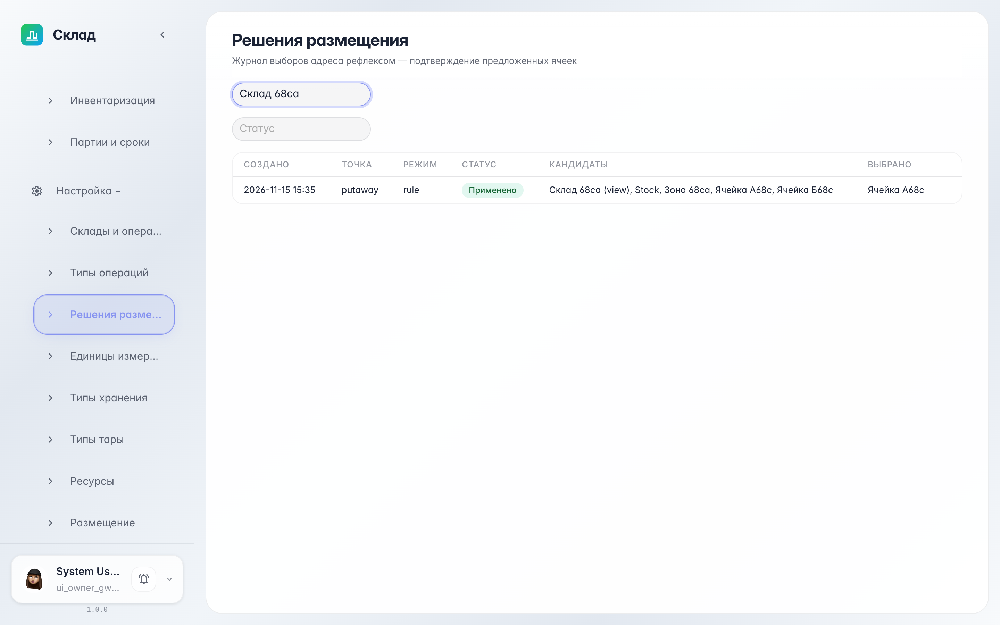
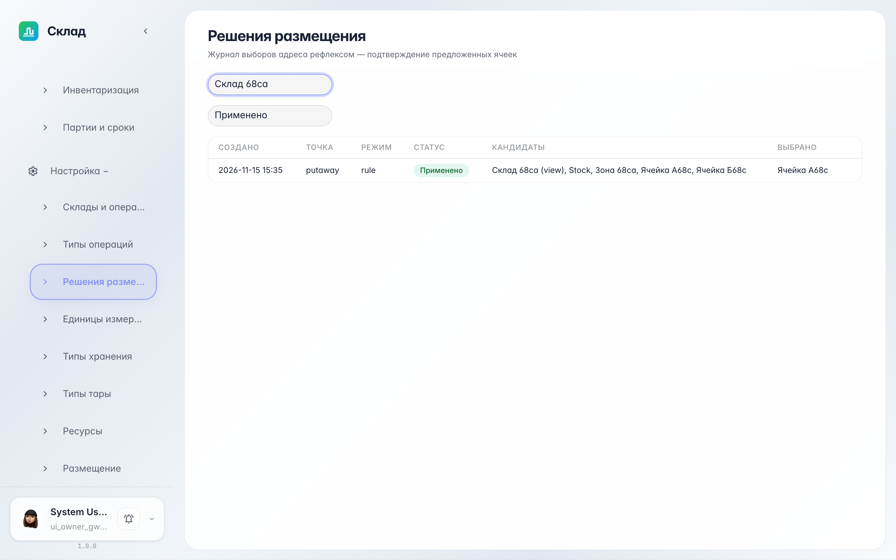

# Рефлекс-решения: аудит выбора ячеек размещения

**Для чего:** когда система или диспетчер выбирает ячейку для товара, выбор записывается как решение — кем, когда и из каких кандидатов.

**Какие проблемы решает:** страница «Решения» — журнал аудита размещений: точка рефлекса, режим, кандидаты и итоговый выбор; фильтр по статусу отделяет применённые от предложенных и отклонённых.

**Результат:** решение о размещении приёмки видно в журнале со статусом «применено» и выбранной ячейкой.

## Шаг 1. Откройте журнал рефлекс-решений

Раздел «Настройки → Решения»: каждое решение — точка автоматики (размещение), режим (правило, inline, тень), список ячеек-кандидатов и итоговый выбор. Статус «применено» — выбор уже исполнен на остатках.

## Шаг 2. Отфильтруйте решения по статусу

**Демонстрация результата.** Фильтр статуса оставляет применённые решения — журнал честно показывает, что выбор ячейки А записан и исполнен.

**Итог.** «Решения» — аудит размещений: кто и почему выбрал ячейку виден из журнала, а не из опроса персонала.

