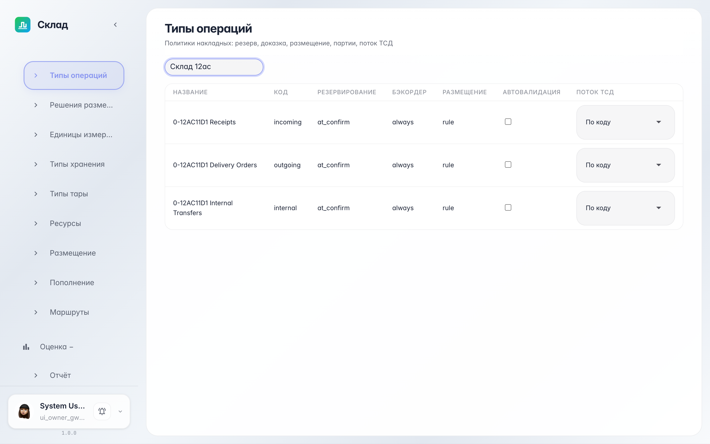
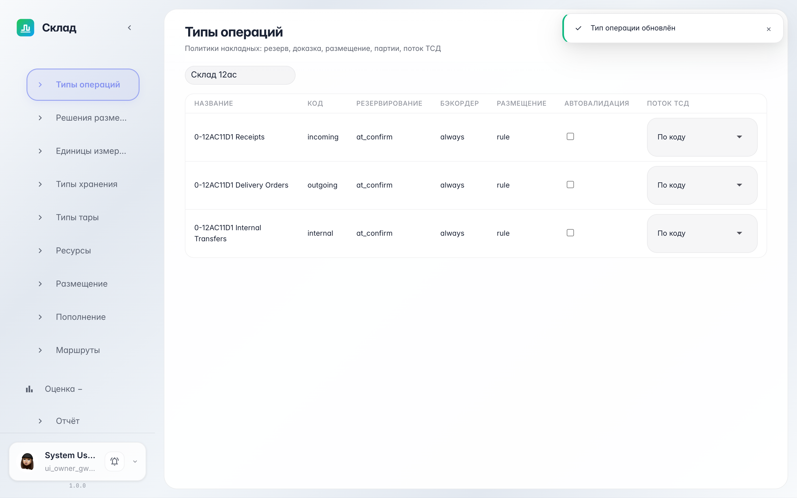

# Operation types: reservation and lot policies

**Purpose:** different warehouse flows behave differently: receiving may create lots, shipping only takes existing ones, urgent orders reserve at confirmation.

**Problems solved:** the full operation-type editor changes handheld behaviour without developers: reservation and backorder policies, putaway, auto-validation, scanner flow and lot rules.

**Result:** «Receipts» type has lot creation disabled and a number prefix set — settings saved and visible in the table.

## Step 1. Open the warehouse operation types

«Settings → Operation types»: each type is the handheld behaviour for its document. The table shows reservation, backorder and putaway policies; a row opens the full editor.

## Step 2. Change the «Receipts» type policies

**Result demonstration.** The editor sets the number prefix «IN-» and disables lot creation: receiving under this type now accepts only an already registered lot and refuses a new one — strict mode for certified supplies.

**Summary.** The operation type is the handheld control panel: every document policy changes in one form and applies at once.

