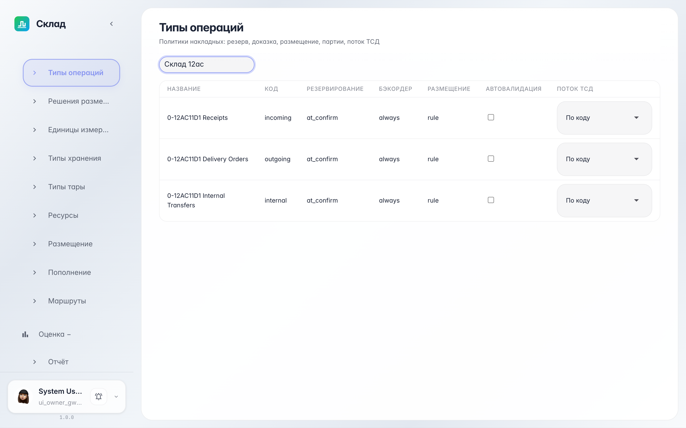
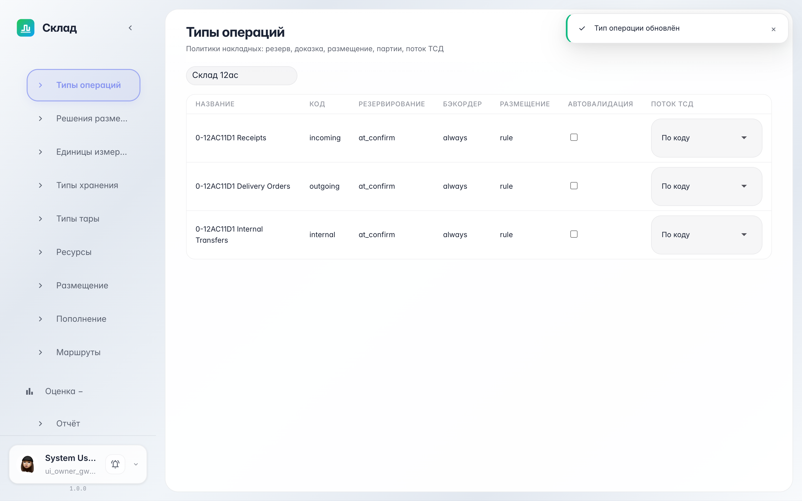

# Типы операций: политики резервов и партий

**Для чего:** разные потоки склада ведут себя по-разному: приёмке можно заводить партии, отгрузке — только брать существующие, у срочных заказов — резерв сразу при подтверждении.

**Какие проблемы решает:** полный редактор типа операции меняет поведение терминалов без программистов: политику резерва и недостачи, размещение, автопроводку, поток сканера и правила партий.

**Результат:** у типа «Receipts» (приёмка) выключено заведение партий и задан префикс номеров — настройки сохранены и видны в таблице.

## Шаг 1. Откройте типы операций склада

Раздел «Настройки → Типы операций»: каждый тип — это поведение терминала по своему документу. Таблица показывает политики резерва, недостачи и размещения; строка открывает полный редактор.

## Шаг 2. Измените политики типа «Receipts»

**Демонстрация результата.** В редакторе задан префикс номеров «IN-» и выключено заведение партий: приёмка под этим типом теперь примет только уже зарегистрированную партию и откажет новой — строгий режим для сертифицированных поставок.

**Итог.** Тип операции — пульт управления терминалом: все политики документа меняются в одной форме и действуют сразу.

