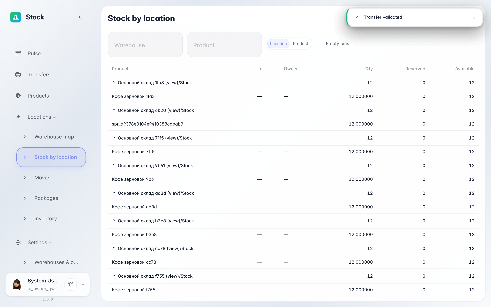
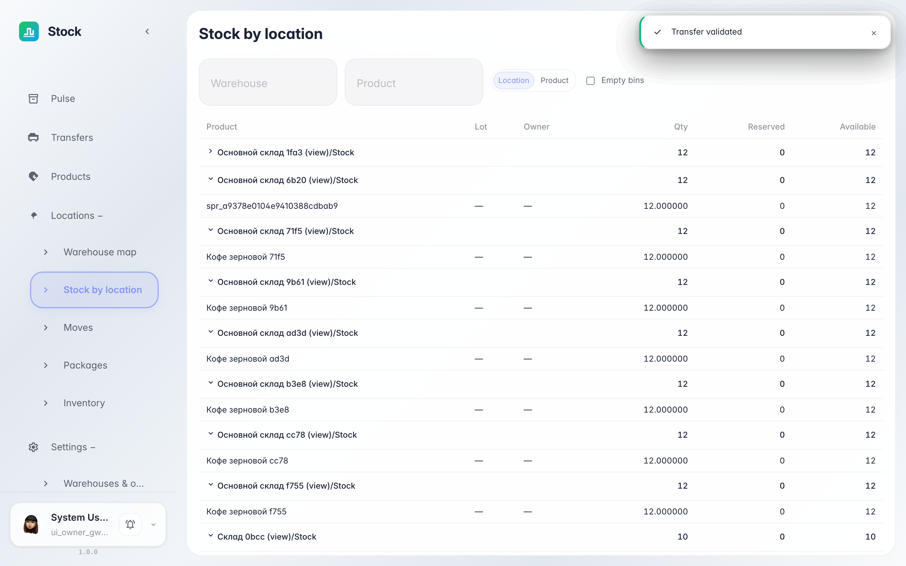

# Stock by location: what sits where

**Purpose:** the Stock by location report answers «where does stock sit and how much is free»: rows are grouped by warehouse addresses with per-location subtotals.

**Problems solved:** no need to open each bin separately — the report shows the whole warehouse at once, and the grouping switch pivots the same selection by product.

**Result:** the screen shows location → product groups with quantity, reserved and available per bin and a grand total.

## Step 1. Open Stock by location

Choose «Locations → Stock by location» in the left menu. Rows are grouped by warehouse addresses: the group header shows the location and its subtotal — quantity, reserved and available. Clicking a group collapses or expands the products inside.

## Step 2. Expand a group and check the total

**Result demonstration.** Inside the group are the bin's products with quantity, reserved and available; the grand total row at the bottom sums the whole selection. The «by location / by product» switch above the table pivots the same selection by product — handy to answer «which bins hold this item».

**Summary.** One report answers both questions — «what sits in this bin» and «where does this product sit».

