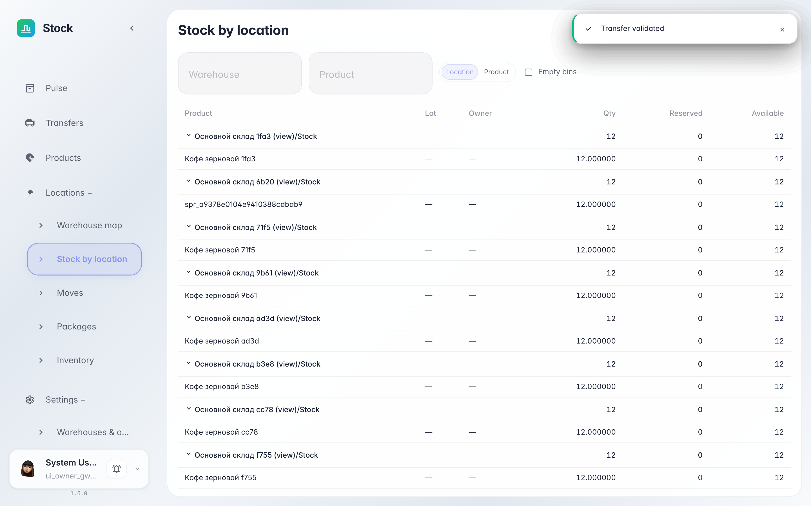
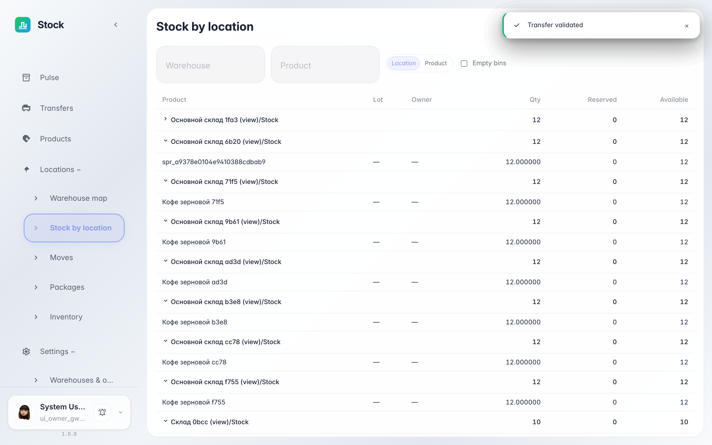

# Остатки по локациям: где что лежит

**Для чего:** отчёт «Остатки по локациям» отвечает на вопрос «где лежит товар и сколько свободно»: строки группируются по адресам склада с субсуммами по каждой ячейке.

**Какие проблемы решает:** не нужно открывать каждую ячейку по отдельности — отчёт показывает весь склад сразу, а переключатель группировки разворачивает ту же выборку по товарам.

**Результат:** на экране — группы «локация → товары» с количеством, резервом и доступным остатком по каждой ячейке и итогом внизу.

## Шаг 1. Откройте «Остатки по локациям»

В меню слева выберите «Локации → Остатки по локациям». Строки сгруппированы по адресам склада: заголовок группы показывает локацию и её субсумму — количество, резерв и доступно. Клик по группе сворачивает и раскрывает товары внутри.

## Шаг 2. Раскройте группу и сверьте итог

**Демонстрация результата.** Внутри группы — товары ячейки с количеством, резервом и доступным остатком; строка «Итого» внизу суммирует всю выборку. Переключатель «по локациям / по товарам» над таблицей меняет разрез: та же выборка группируется по товарам — удобно ответить «в каких ячейках лежит эта позиция».

**Итог.** Один отчёт отвечает на оба вопроса — «что лежит в ячейке» и «где лежит товар».

