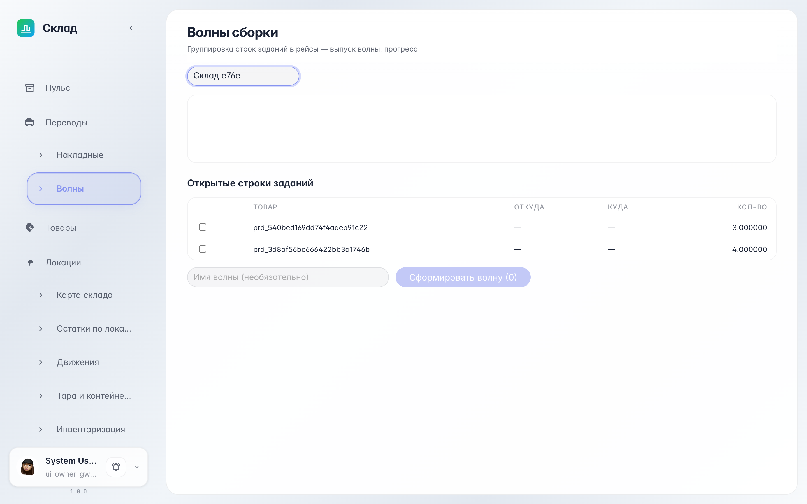
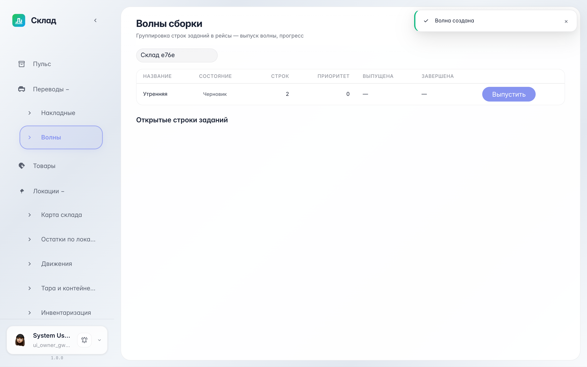
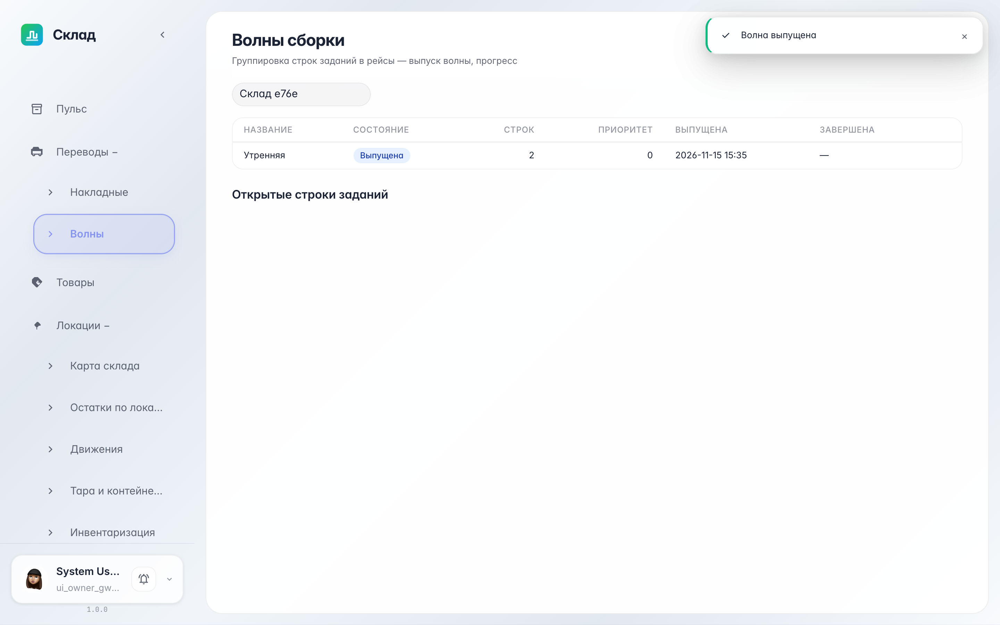

# Pick waves: group order lines into one wave

**Purpose:** in the morning a dispatcher faces dozens of outbound orders — an operator prefers picking lines of several orders in one rack pass instead of visiting every document.

**Problems solved:** the «Waves» page lists every free pick line of the warehouse — the dispatcher ticks the ones needed, names the wave and releases it to work with one button.

**Result:** two lines merged into the «Morning» wave, the wave released — its lines appear to handheld operators as tasks.

## Step 1. Open «Waves» and pick the warehouse

«Orders → Waves» lists the warehouse's free pick lines: product, source bin, direction and quantity. This is physically executable work not yet claimed by anyone.

## Step 2. Build a wave from the ticked lines

Tick the lines an operator will grab in one pass, type the wave name and press «Create». The wave appears as a draft — it can still be rethought before release.

## Step 3. Release the wave to work

**Result demonstration.** The «Release» button on a draft sends the wave to work: the row state changes to «Released» and its lines reach handheld operators as wave-tagged tasks.

**Summary.** Waves merge picking of several orders into one pass: free lines → tick → name → «Create» → «Release».

