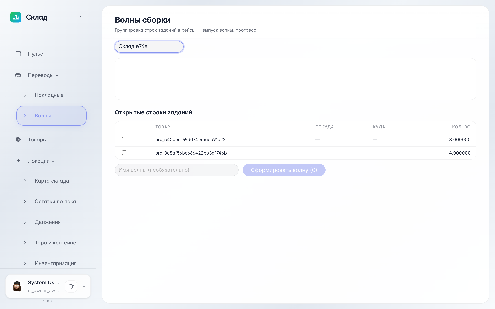
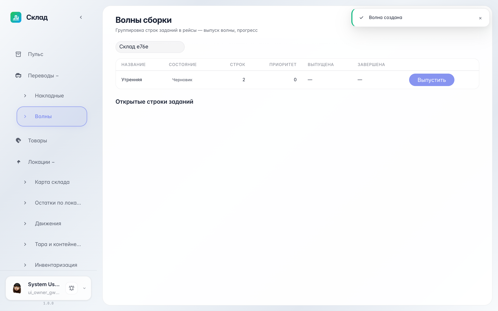
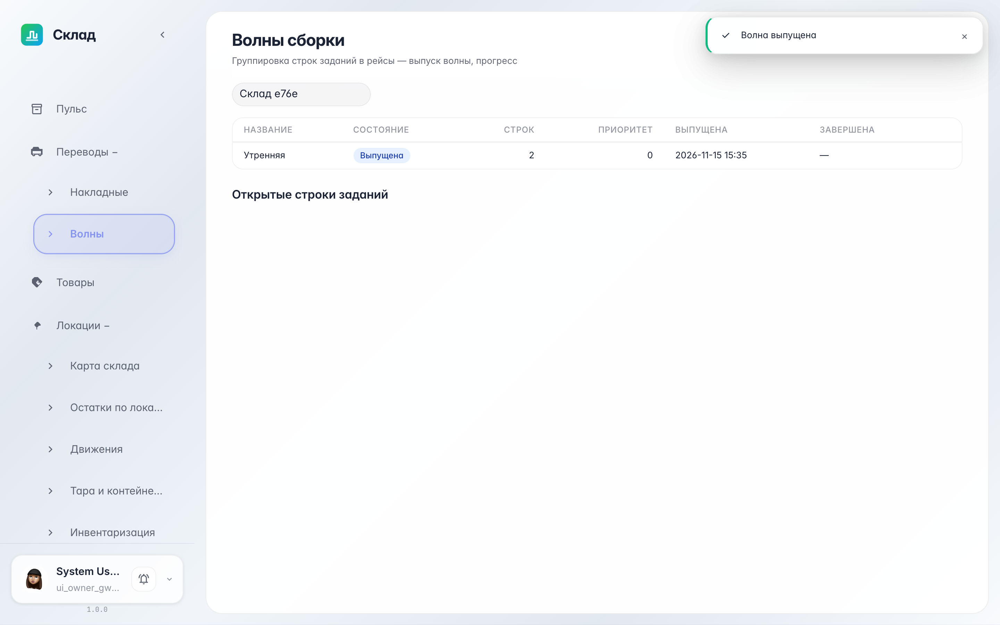

# Волны сборки: объединить строки заказов в одну волну

**Для чего:** утром у диспетчера десятки накладных на отгрузку — оператору удобнее забрать позиции нескольких заказов одним обходом стеллажей, чем бегать по каждому документу.

**Какие проблемы решает:** страница «Волны» показывает все свободные строки отбора склада — диспетчер отмечает нужные, называет волну и выпускает её в работу одной кнопкой.

**Результат:** строки двух позиций объединены в волну «Утренняя», волна выпущена — её строки видны операторам терминалов как задания.

## Шаг 1. Откройте «Волны» и выберите склад

Раздел «Накладные → Волны» показывает свободные строки отбора склада: товар, ячейка-источник, направление и количество. Это физически исполнимая работа, ещё не закреплённая ни за кем.

## Шаг 2. Соберите волну из отмеченных строк

Отметьте строки, которые оператор заберёт одним обходом, впишите имя волны и нажмите «Создать». Волна появляется черновиком — её ещё можно переосмыслить до выпуска.

## Шаг 3. Выпустите волну в работу

**Демонстрация результата.** Кнопка «Выпустить» у черновика переводит волну в работу: статус строки меняется на «Выпущена», а её позиции уходят операторам терминалов как задания с пометкой волны.

**Итог.** Волны объединяют отбор нескольких заказов в один обход: свободные строки → отметить → имя → «Создать» → «Выпустить».

