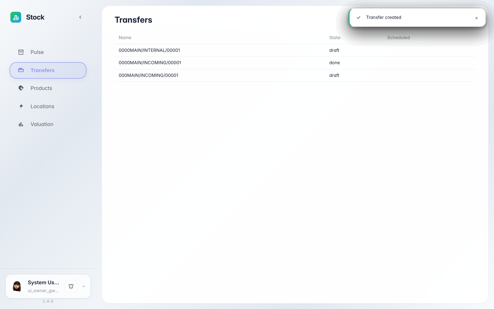
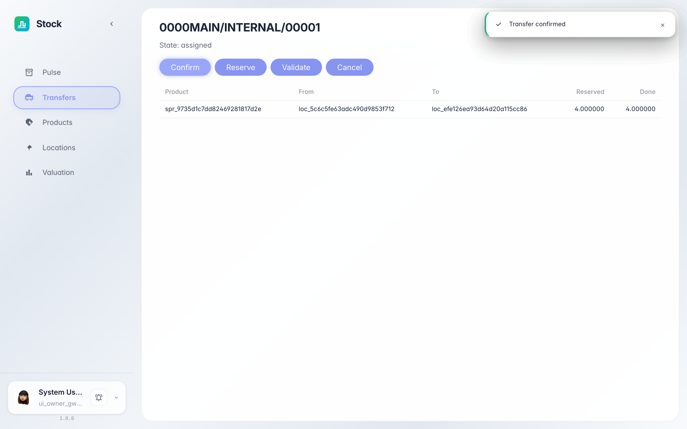
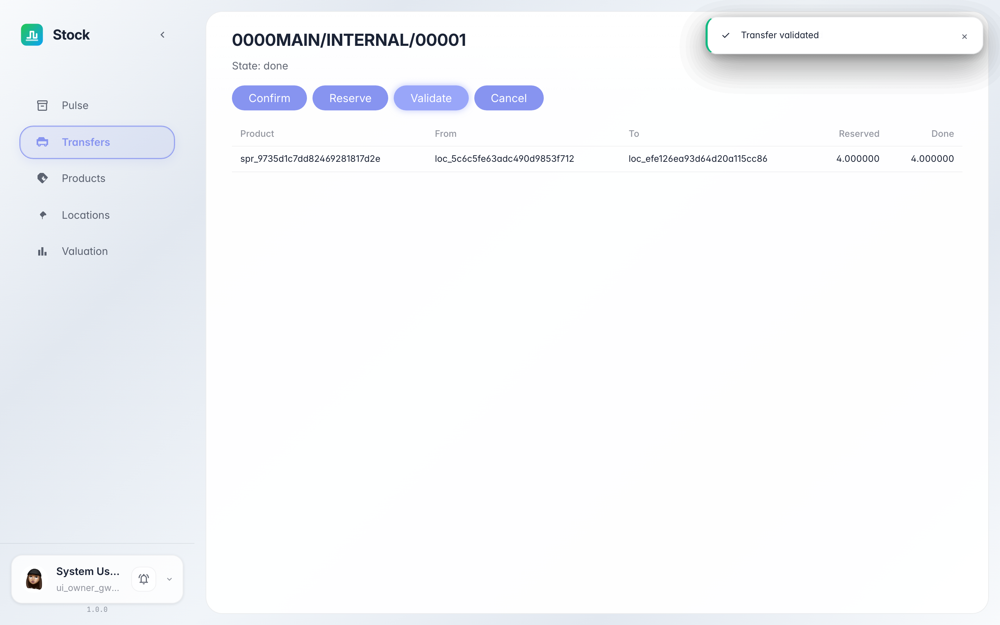

# Moving stock between warehouse bins

**Purpose:** an internal transfer moves a product's stock from one bin to another — e.g. from the receiving zone to its storage slot.

**Problems solved:** you will learn how to register a move, push it through the states and verify the goods changed bins.

**Result:** the move is validated — the stock left the source bin and appeared in the destination.

## Step 1. Find the move in the journal

An internal move creates an «internal» document. In the «Transfers» journal it sits next to the receipt: same states and the same card — a line «from» and a line «to».

## Step 2. Confirm the move

Click «Confirm» — the system reserves 4 units in the source bin: they are still there but unavailable for other operations. The state becomes «reserved».

## Step 3. Validate the move

Once the goods are physically moved, click «Validate». The «done» state means the stock left bin A and was posted to bin B.

**Summary.** Every rearrangement in the warehouse is a document: the journal shows what moved where, and the stock figures stay exact.

