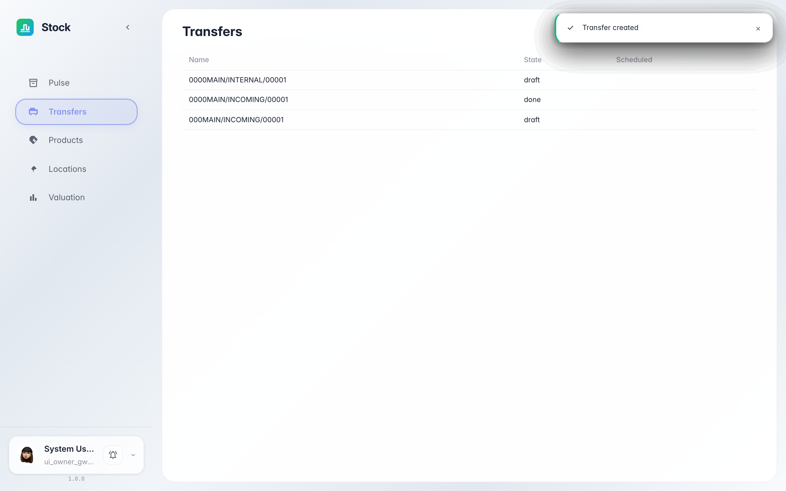
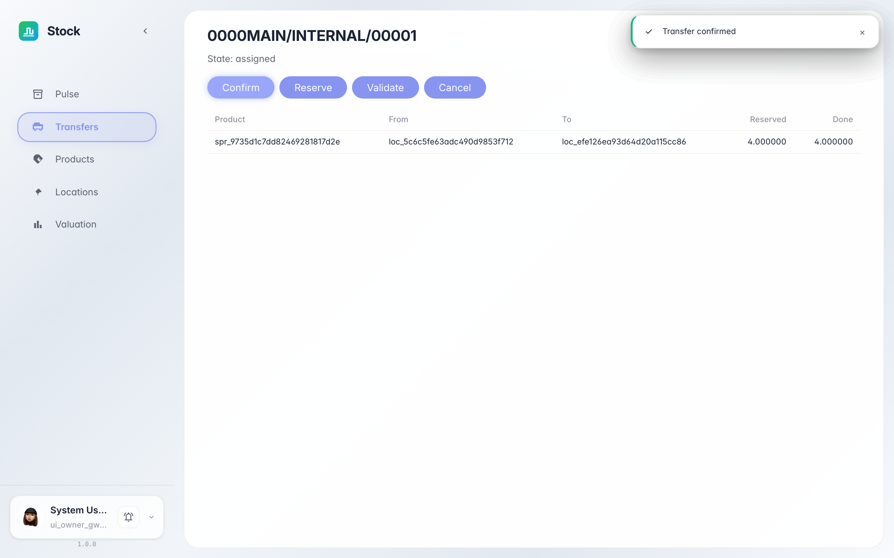
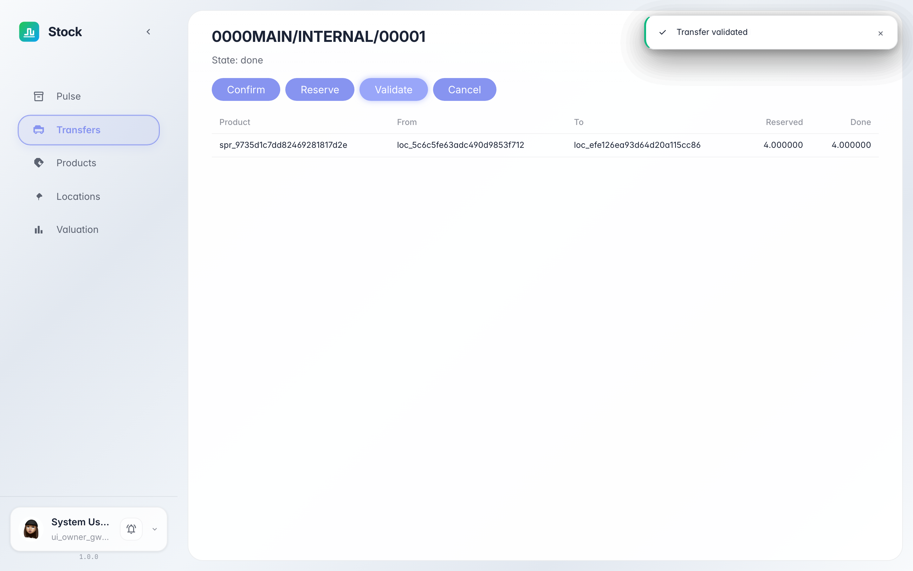

# Перемещение товара между ячейками склада

**Для чего:** внутреннее перемещение перекладывает остаток товара из одной ячейки в другую — например, из зоны приёмки на место хранения.

**Какие проблемы решает:** вы узнаете, как оформить перемещение, провести его по статусам и убедиться, что товар сменил ячейку.

**Результат:** перемещение проведено — остаток ушёл из исходной ячейки и появился в целевой.

## Шаг 1. Найдите перемещение в журнале

Внутреннее перемещение создаёт документ с типом «внутренний». В журнале «Переводы» он виден рядом с поступлением: у него те же статусы и та же карточка — из строки «откуда» в строку «куда».

## Шаг 2. Подтвердите перемещение

Нажмите «Подтвердить» — система резервирует 4 шт. в исходной ячейке: они ещё на месте, но уже недоступны для других операций. Статус — «зарезервирован».

## Шаг 3. Проведите перемещение

Когда товар физически переложен, нажмите «Провести». Статус «проведён» — остаток снят с ячейки A и зачислен в ячейку B.

**Итог.** Любая перестановка на складе оформляется документом: журнал показывает, что и откуда куда переехало, а остатки остаются точными.

