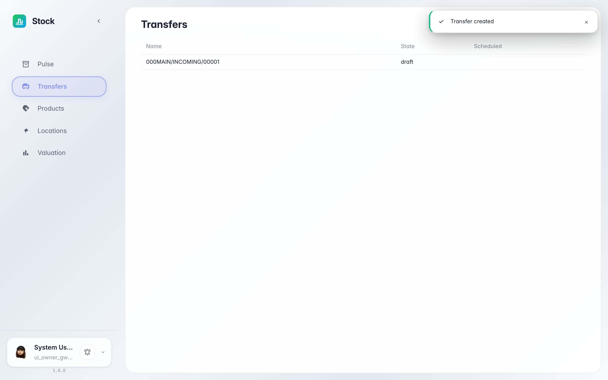
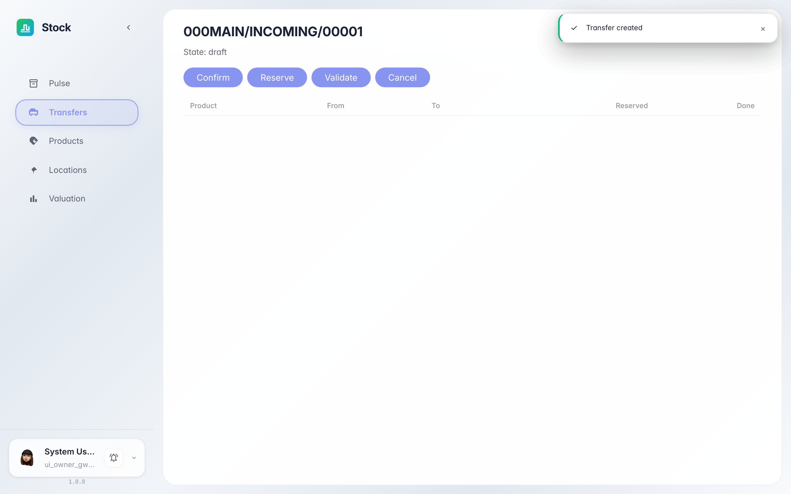

# Transfers journal: document states

**Purpose:** «Transfers» is the journal of all warehouse documents: receipts, deliveries and internal moves.

**Problems solved:** you will learn to read document states «draft → reserved → done», find the document you need and open its card.

**Result:** you can navigate the journal and open any warehouse document's card.

## Step 1. Open Transfers

Choose «Transfers» in the left menu — the journal of all warehouse documents. Each row shows the operation type, state and time: a new document starts as «draft» — it does not affect stock yet.

## Step 2. Open the document card

Click the row to open the card: a header with the state and action buttons, and document lines with product and quantity below. The buttons move the document through its lifecycle: «Confirm» reserves the task, «Validate» posts the stock.

**Summary.** The journal is the warehouse's control feed: every goods movement is listed here and verifiable in its card.

