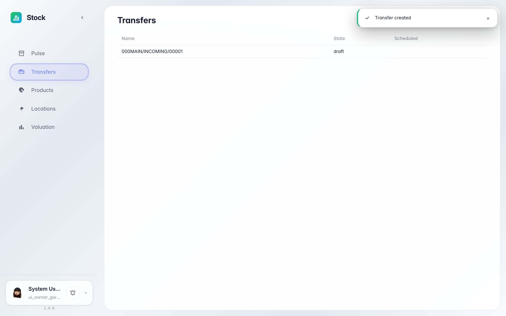
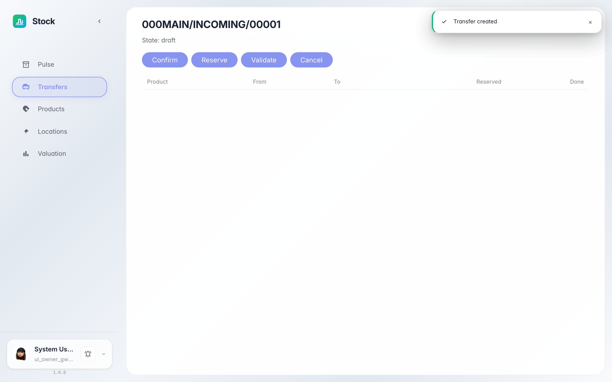

# Журнал переводов: статусы документов

**Для чего:** «Переводы» — журнал всех складских документов: поступления, отгрузки и внутренние перемещения.

**Какие проблемы решает:** вы увидите, как читать статусы документа «черновик → зарезервирован → проведён», где найти нужный документ и что показывает его карточка.

**Результат:** вы ориентируетесь в журнале и открываете карточку любого складского документа.

## Шаг 1. Откройте «Переводы»

В меню слева выберите «Переводы» — это журнал всех складских документов. В строке видны тип операции, статус и время: новый документ начинается со статуса «черновик» — он ещё не влияет на остатки.

## Шаг 2. Откройте карточку документа

Клик по строке открывает карточку: шапка со статусом и кнопки действий, ниже — строки документа с товаром и количеством. Кнопки сверху ведут документ по жизненному циклу: «Подтвердить» резервирует задание, «Провести» списывает или зачисляет остатки.

**Итог.** Журнал — это контрольная лента склада: любое движение товара вы найдёте здесь и проверите по карточке.

