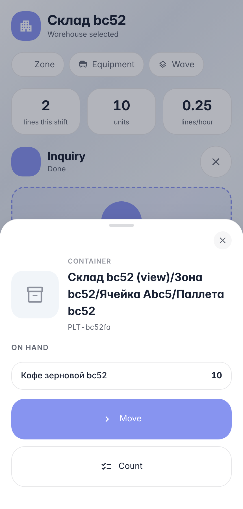
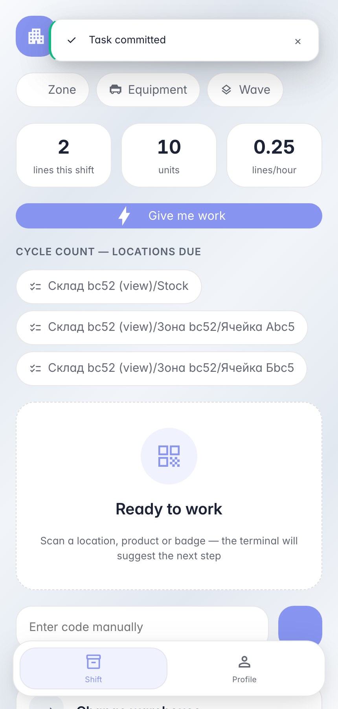

# Moving a container on the handheld: pallet and all

**Purpose:** relocating a pallet/box as a unit — its contents travel with it, no unpacking or re-scanning every item.

**Problems solved:** one container scan shows its contents; moving it takes a single destination scan — stock inside stays bound to the container.

**Result:** a loaded pallet is re-hung under a new bin — one operation in the system and on the floor.

## Step 1. Scan a pallet — see its load

A container is a location too: the pallet card shows the stock inside. «Move» relocates the whole pallet — no lines to enter.

## Step 2. Pallet under the new bin — load intact

**Result demonstration.** The pallet was re-hung under bin B in one operation — stock stayed bound to the container, nothing had to be «unpacked».

**Summary.** Moving a container: scan pallet → «Move» → scan destination bin → commit.

