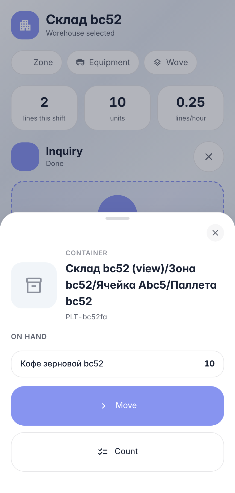
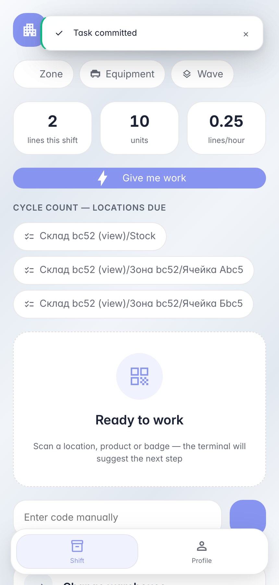

# Перевоз тары на терминале: паллета вместе с товаром

**Для чего:** перевозка паллеты/короба целиком — содержимое едет вместе с тарой, разбирать и пересканировать каждый товар не нужно.

**Какие проблемы решает:** один скан тары показывает её содержимое; перемещение — скан целевой ячейки, товар внутри остаётся привязан к таре.

**Результат:** паллета с товаром переподвешена под новую ячейку — в системе и физически одна операция.

## Шаг 1. Отсканируйте паллету — видно её груз

Тара — тоже локация: карточка паллеты показывает товар внутри неё. «Переместить» перевезёт паллету целиком — строки набирать не нужно.

## Шаг 2. Паллета под новой ячейкой — груз на месте

**Демонстрация результата.** Паллета переподвесилась под ячейку Б одной операцией — остаток остался привязан к таре, ничего «разбирать» не пришлось.

**Итог.** Перевоз тары: скан паллеты → «Переместить» → скан целевой ячейки → проводка.

