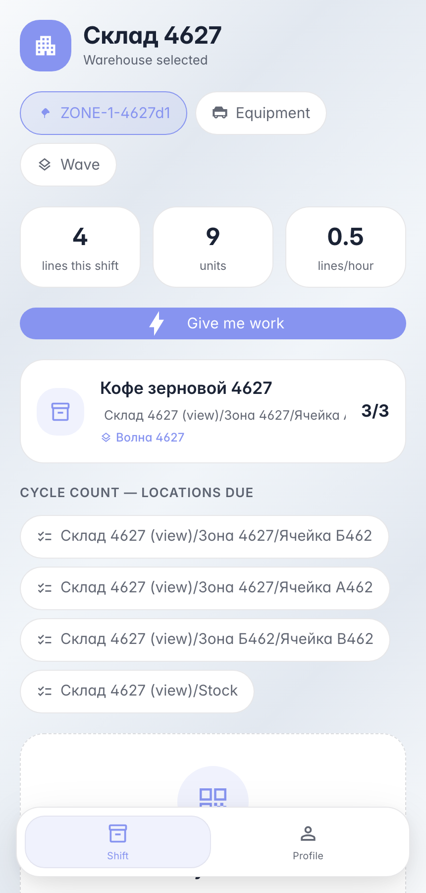
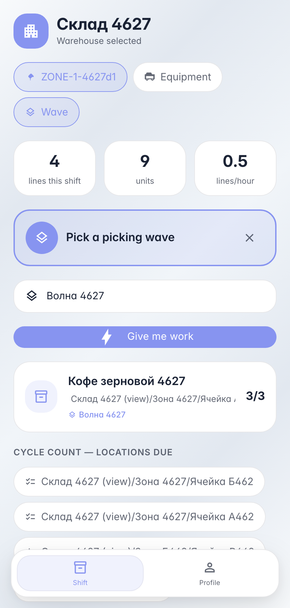
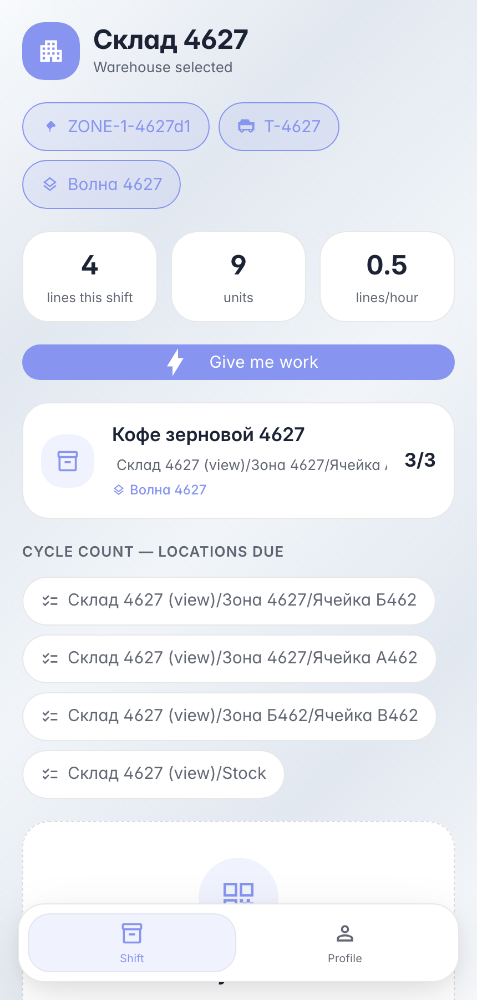
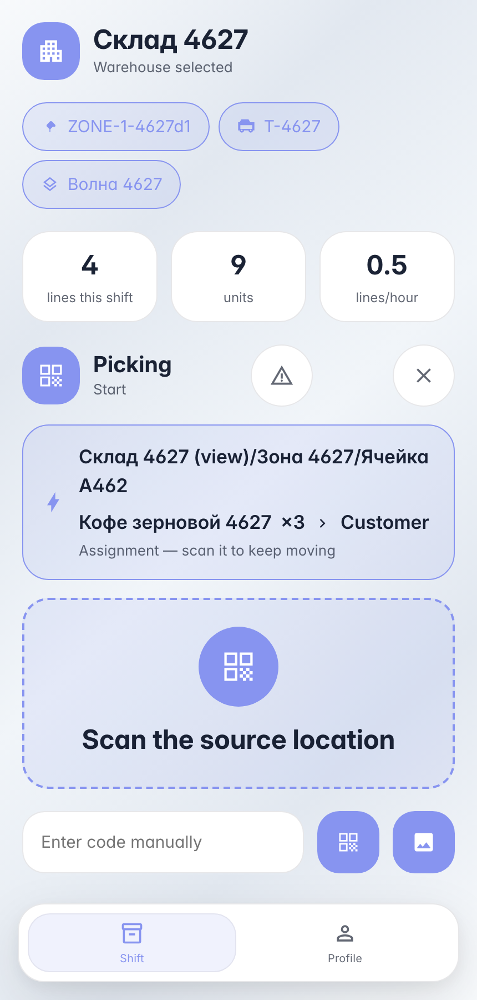

# Shift context: zone, wave and equipment narrow the work

**Purpose:** the operator physically stands in their zone with their cart — showing tasks from the far end of the warehouse is pointless. Context chips switch the terminal to «my zone / my wave / my equipment» mode.

**Problems solved:** binding is one tap and one scan: the zone chip arms and a zone barcode narrows the queue to that bin subtree; the wave is picked from the dispatcher-released list; the cart binds via its barcode and takes part in work assignment (the resource filters tasks by capability).

**Result:** «give me work» issues exactly the task the operator can and should do first.

## Step 1. Zone scan — the queue narrows to my subtree

The operator entered zone A: one tap on the chip and one scan of the zone barcode — the chip is lit as bound, and the queue keeps only work from that zone's bins. The task from bin C (other zone) is no longer offered.

## Step 2. Released waves — the dispatcher sliced the route

A wave is the dispatcher-sliced pick route: the terminal lists only waves released for this warehouse. The wave is picked by tap — a batch has no physical barcode.

## Step 3. Context assembled: zone + wave + cart

Three chips bound with two scans and one tap: the terminal now answers «what to do» with physics in mind — where I stand, which route is released, and what I'm driving. The cart is server-bound to the operator — a second terminal can't steal it.

## Step 4. «Give me work» — first line of the bound context

**Result demonstration.** Issue passed the triple zone + wave + resource filter: execution opened on the coffee line from zone A — the wave's task. The line was claimed for the operator in the same transaction.

**Summary.** Context: zone chip → scan → wave chip → tap → equipment chip → scan → «give me work».

