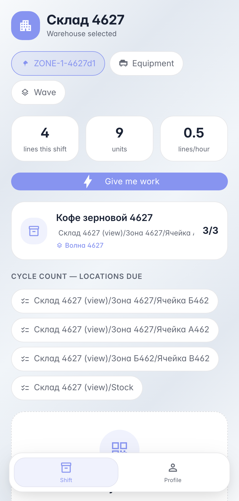
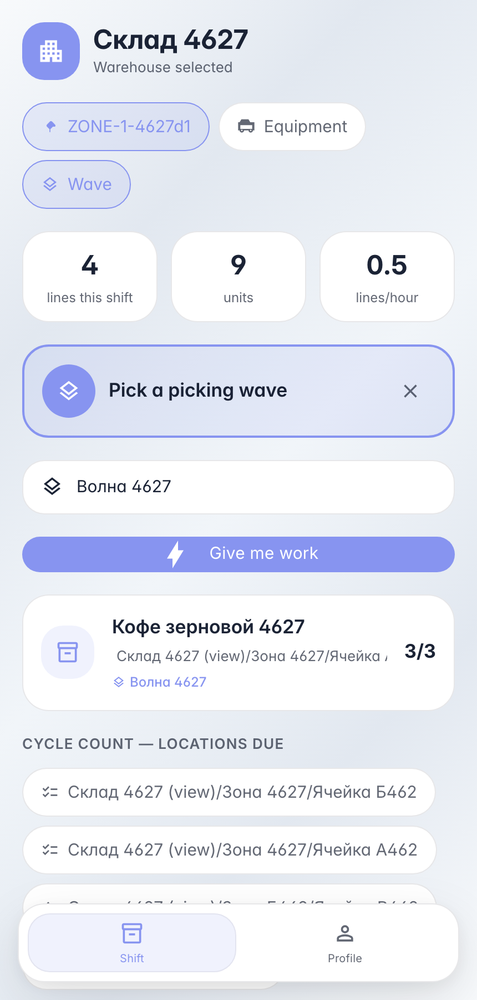
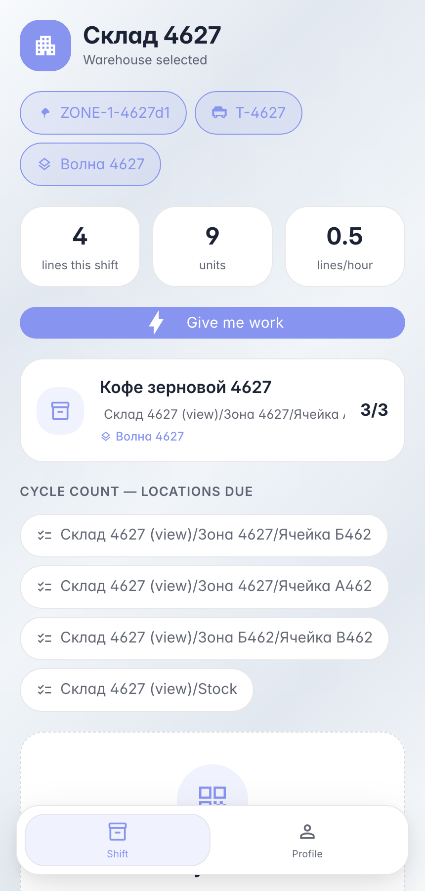
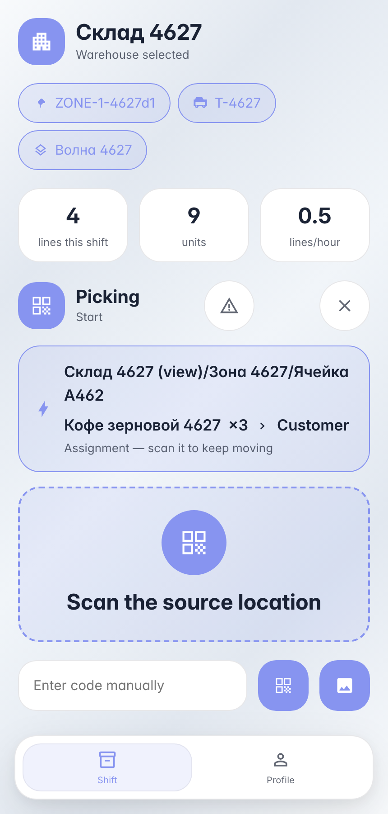

# Контекст смены: зона, волна и техника сужают работу

**Для чего:** оператор физически стоит в своей зоне со своей тележкой — показывать ему задания с другого конца склада бессмысленно. Чипы контекста переводят терминал в режим «моя зона / моя волна / моя техника».

**Какие проблемы решает:** привязка — один тап и один скан: чип зоны взводится и баркод зоны сужает очередь до поддерева ячеек; волна выбирается из списка отпущенных диспетчером; тележка привязывается её баркодом и участвует в выдаче работы (ресурс фильтрует задания по возможностям).

**Результат:** «дайте работу» выдаёт именно то задание, которое оператор способен и должен сделать первым.

## Шаг 1. Скан зоны — очередь сужена до моего поддерева

Оператор вошёл в зону А: тап по чипу и один скан баркова зоны — чип подсвечен привязкой, а в очереди осталась только работа из ячеек этой зоны. Задание с ячейки В (другая зона) терминал больше не предлагает.

## Шаг 2. Отпущенные волны — диспетчер нарезал маршрут

Волна — нарезанный диспетчером маршрут отбора: терминал показывает только отпущенные волны склада. Выбор волны — тапом: у партии нет физического баркода.

## Шаг 3. Контекст собран: зона + волна + тележка

Три чипа привязаны двумя сканами и одним тапом: терминал теперь отвечает на вопрос «что делать» с учётом физики — где я стою, какой маршрут отпущен и на чём я еду. Тележка числится занятой за оператором на сервере — второй терминал её не уведёт.

## Шаг 4. «Дайте работу» — первая строка связанного контекста

**Демонстрация результата.** Выдача прошла через тройной фильтр зоны + волны + ресурса: исполнение открылось на строке кофе из зоны А — задании волны. Строка захвачена за оператором в той же транзакции.

**Итог.** Контекст: чип зоны → скан → чип волны → тап → чип техники → скан → «дайте работу».

