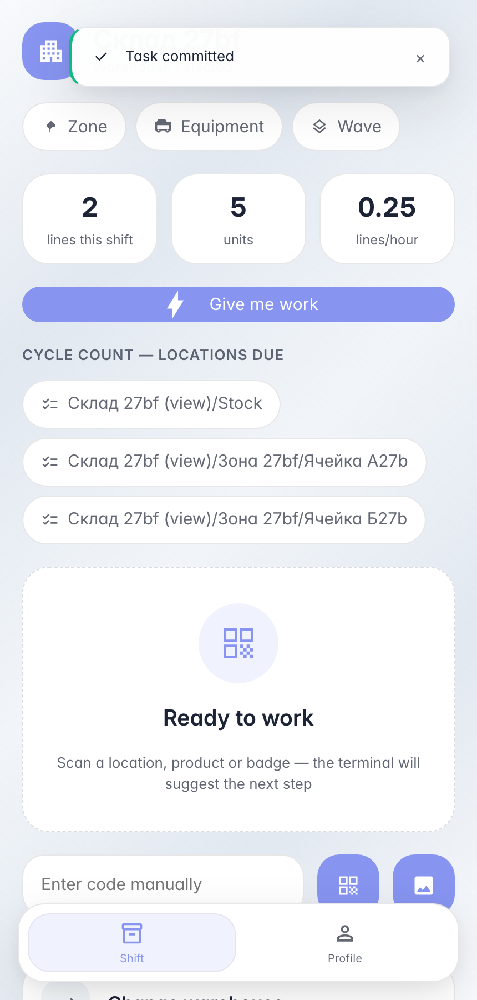

# Пересчёт до нуля: «в ячейке пусто» — тоже факт

**Для чего:** оператор дошёл до ячейки и физически видит пустоту — система обязана принять нулевой факт, а не заставлять вводить ложное количество.

**Какие проблемы решает:** ноль — легальное количество только в пересчёте: записывается как факт инвентаризации и даёт расхождение на утверждение, вместо отказа «количество должно быть больше нуля».

**Результат:** факт 0 записан на остаток ячейки, расхождение −5 видно системе.

## Шаг 1. Факт 0 принят — review показывает расхождение

Учётно на ячейке 5, физически пусто: «0» — честный факт пересчёта, не ошибка ввода. Строка готова к проводке — система запишет факт и отметит минус 5 для сверки.

## Шаг 2. Факт нуля лёг на остаток — расхождение видно

**Демонстрация результата.** На остатке ячейки записан факт инвентаризации 0 — разница с учётными 5 уйдёт на утверждение корректировки.

**Итог.** «Пустая ячейка» вводится как 0 — терминал не требует выдумывать количество.

