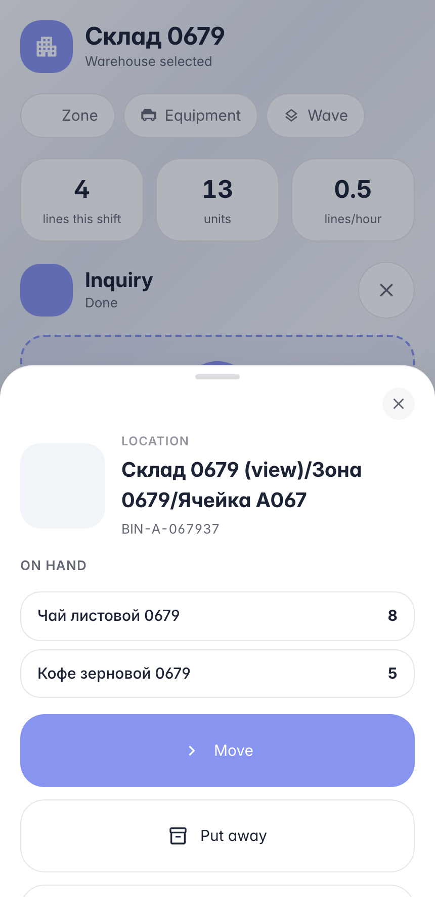
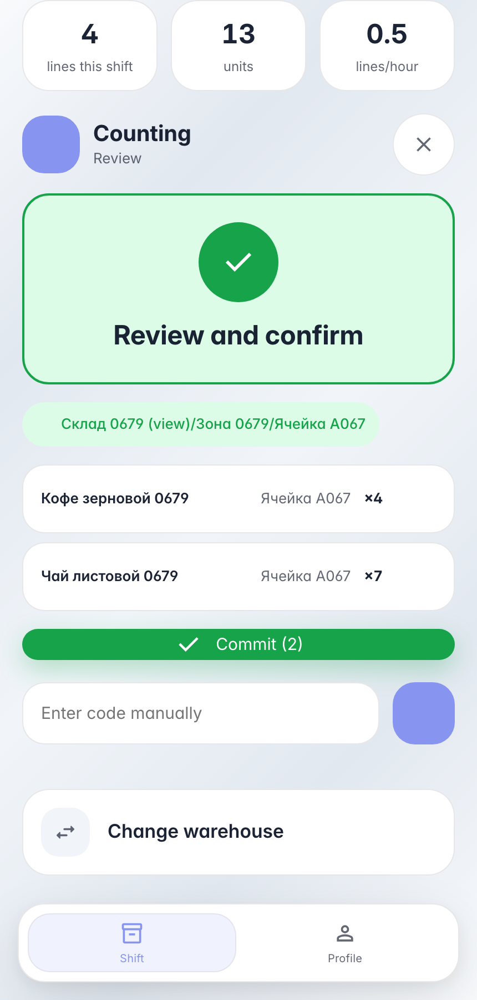

# Cycle counting a bin on the handheld

**Purpose:** cycle counting — the operator recounts a bin's physical stock; the system records the counted fact for reconciliation against book stock.

**Problems solved:** one bin scan opens the count — products are entered one after another in a single session, variance is recorded for approval.

**Result:** two products counted with variances, the counted fact is written onto the bin's stock.

## Step 1. Scan a bin — book contents

The bin card shows book stock: «Coffee» — 5, «Tea» — 8. «Count» starts a cycle count — the bin is already the source; just scan products one after another.

## Step 2. Count products in a row — one commit

Counting is a flow: scan product → counted quantity → next product. The bin stays between lines — no need to rescan it. Review shows both lines before commit.

