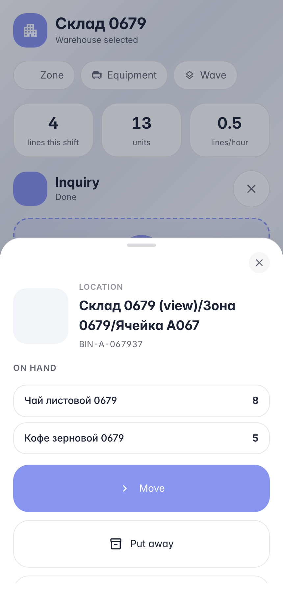
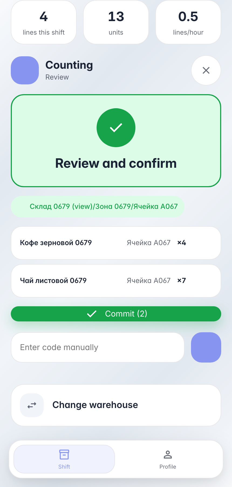

# Пересчёт ячейки на терминале: факт против остатка

**Для чего:** циклический пересчёт — оператор пересчитывает физический остаток ячейки, система фиксирует факт для сверки с учётным.

**Какие проблемы решает:** один скан ячейки открывает пересчёт — товары набираются подряд в одну сессию, расхождение фиксируется для утверждения.

**Результат:** два товара пересчитаны с отклонениями, факт записан на остатки ячейки.

## Шаг 1. Отсканируйте ячейку — учётное содержимое

Карточка ячейки показывает учётный остаток: «Кофе» — 5, «Чай» — 8. Кнопка «Посчитать» стартует цикл-пересчёт — ячейка уже подставлена как источник, осталось набирать товары подряд.

## Шаг 2. Пересчитайте товары подряд — строки в одну проводку

Пересчёт идёт потоком: скан товара → фактическое количество → следующий товар. Ячейка удерживается между строками — пересканировать её не нужно. Review показывает обе строки перед проводкой.

