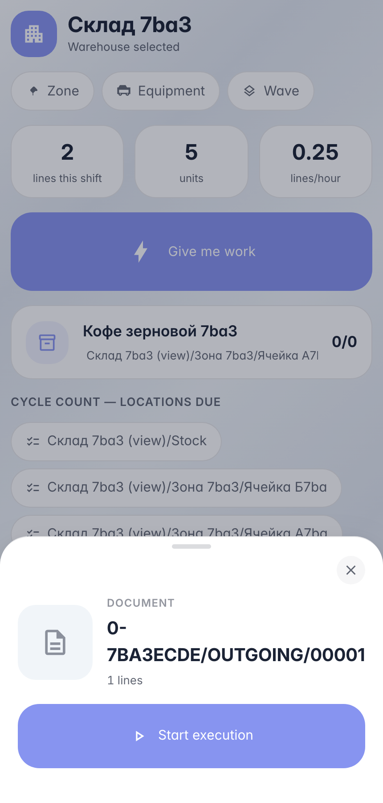
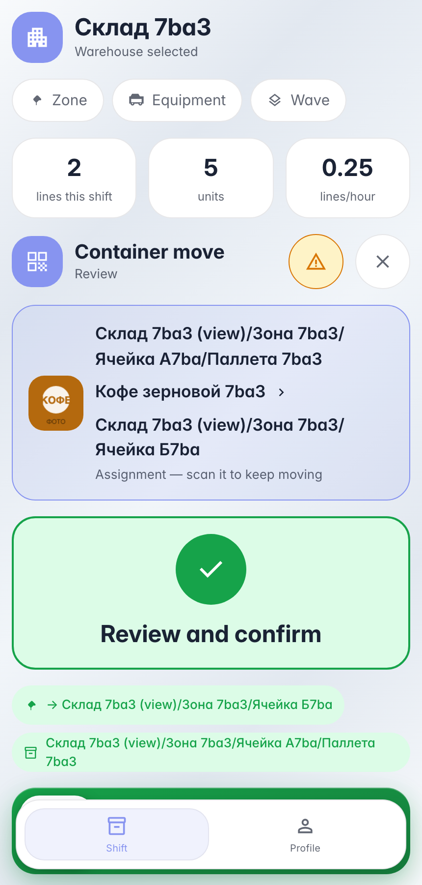

# Pallet task: the document drives container hauling

**Purpose:** shipping a whole pallet — the dispatcher released an order with the «least containers» strategy, the system reserved a full pallet and issued a «haul the container» task instead of «pick pieces».

**Problems solved:** the backend picks the flow from the document line kind — the terminal asks for the container scan, then the destination; nothing needs unpacking.

**Result:** the pallet with all contents moved to the shipping zone in one commit.

## Step 1. The order reserved the whole pallet

The «least containers» strategy found a homogeneous pallet covering the order: the task line says «haul the container», not «pick 5 pieces». The document card offers to start execution.

## Step 2. The flow asked for the container, then destination

The backend picked the flow from the line kind: first the pallet scan, then the destination bin. No unpacking or re-scanning the contents.

