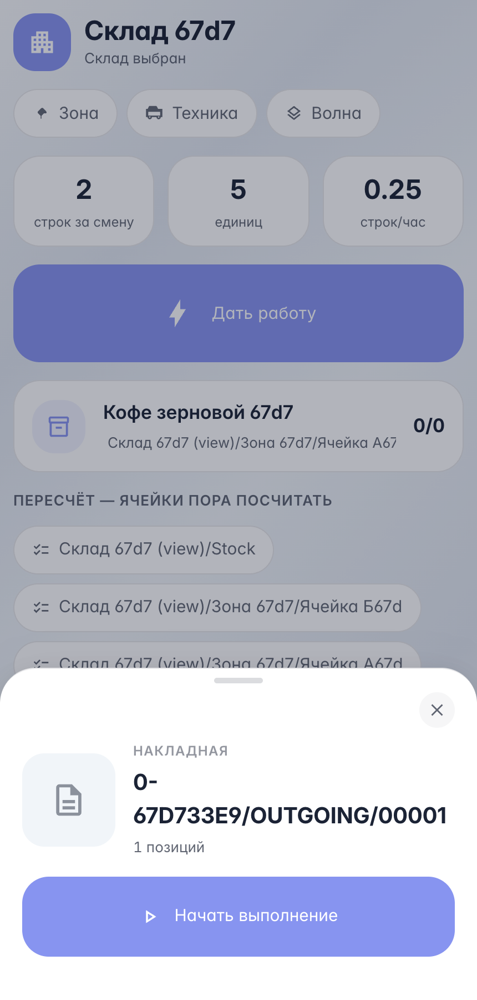
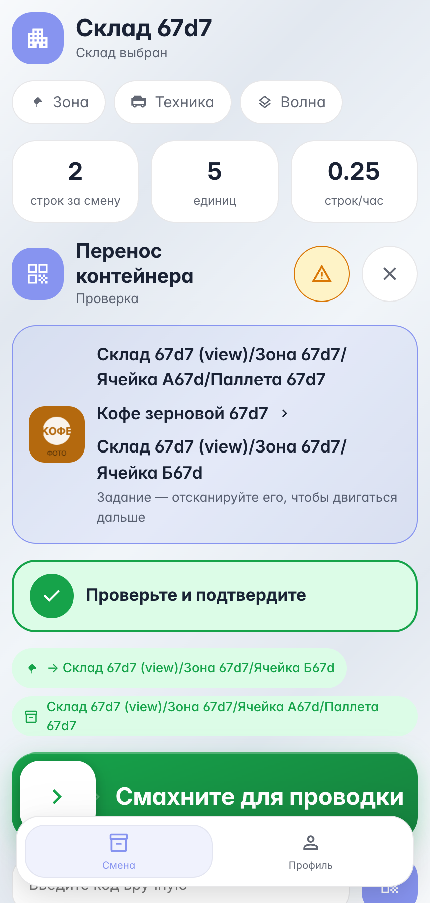
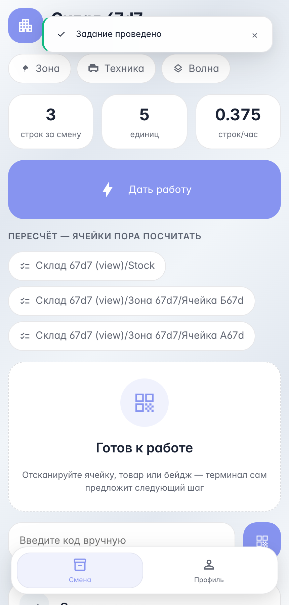

# Задание на паллету: документ ведёт перевоз тары

**Для чего:** отгрузка целой паллеты — диспетчер отпустил накладную со стратегией «минимум тары», система зарезервировала паллету целиком и выдала задание «увезти тару», а не «набрать штуки».

**Какие проблемы решает:** backend сам выбирает поток по kind строки документа — терминал просит скан тары, затем приёмник; товар разбирать не нужно.

**Результат:** паллета со всем содержимым переехала в зону отгрузки одним коммитом.

## Шаг 1. Накладная резервировала паллету целиком

Стратегия «минимум тары» нашла однородную паллету, покрывающую заказ: строка задания — «увезти тару», а не «набрать 5 штук». Карточка документа предлагает начать исполнение.

## Шаг 2. Поток просил тару, затем приёмник

Backend выбрал поток по kind строки: сначала скан паллеты, потом ячейки-приёмника. Разбирать тару и пересканировать содержимое не нужно.

## Шаг 3. Паллета под новой ячейкой — товар ехал внутри

**Демонстрация результата.** Контейнер переподвешен под ячейку Б, все 5 кофе остались внутри — физически и в системе это была одна операция «перевезти тару».

**Итог.** Документ сам выбрал поток перевозки: скан накладной → паллета → приёмник → проводка.

