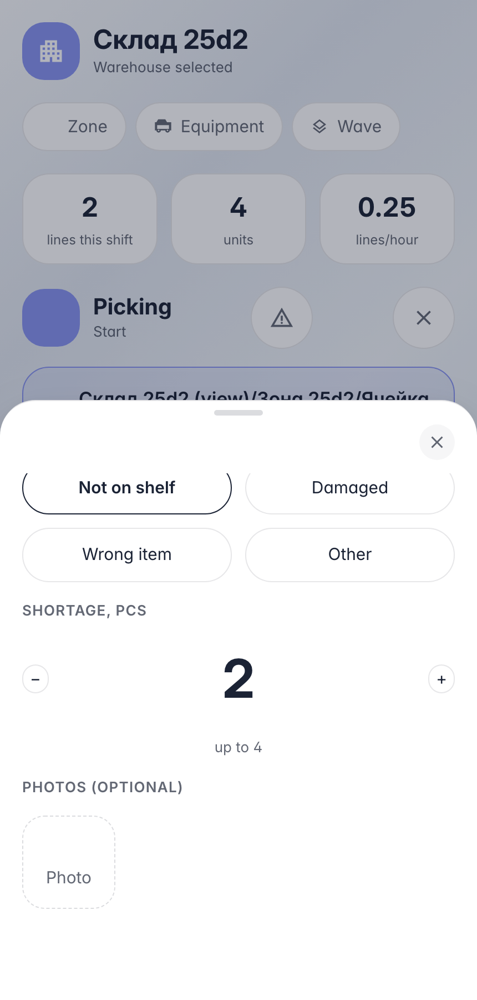

# Line problem: shortage reported right from execution

**Purpose:** the operator reached the assigned bin — the shelf is empty or goods are damaged. Execution shouldn't stop silently, the fact must be recorded honestly.

**Problems solved:** the problem button on the run screen opens a sheet: reason, shortage, photos. The backend shortens the line, releases the empty spot's reservation and schedules a recount — the ledger is fixed by inventory, not by «not found».

**Result:** shortage recorded, reserve freed, session closed — the queue gives the next work.

## Step 1. Problem sheet: reason and shortage

The operator physically cannot fulfil the line — the goods are missing. The sheet asks the reason and how many are short; photos attach as escalation evidence.

## Step 2. Shortage recorded — line and reserve reconciled

**Result demonstration.** The line shortened 4 → 2, the bin reserve released — the «promise» on the empty spot is lifted, nobody else will be sent there. A recount task is set: inventory fixes the book quantity.

**Summary.** Problem: execution → button → reason + shortage → report.

