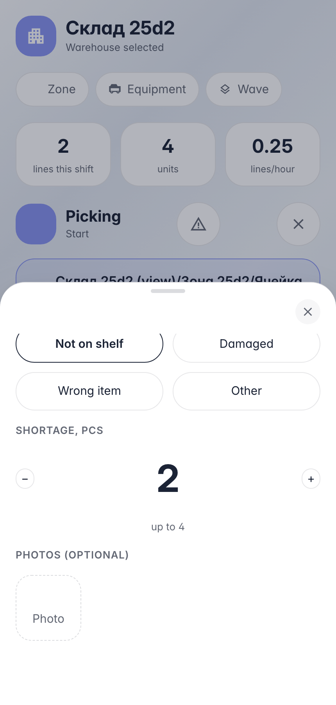

# Проблема на линии: недостача репортится прямо из исполнения

**Для чего:** оператор пришёл за товаром по заданию — а полка пуста или товар битый. Исполнение останавливать нельзя, но факт надо зафиксировать честно.

**Какие проблемы решает:** кнопка проблемы на экране исполнения открывает лист: причина, недостача, фото. Backend укорачивает строку, отпускает резерв пустого места и ставит ячейке задание пересчёта — книжный остаток исправит инвентаризация, а не «не нашли».

**Результат:** недостача записана, резерв снят, сессия закрыта — следующую работу даст очередь.

## Шаг 1. Лист проблемы: причина и недостача

Оператор физически не может выполнить строку — товара нет. Лист спрашивает причину и сколько недостаёт; фото прикладываются как доказательство для эскалации.

## Шаг 2. Недостача записана — строка и резерв сошлись

**Демонстрация результата.** Строка укорочена 4 → 2, резерв на ячейке отпущен — «обещание» на пустое место снято, никто больше сюда не поедет. Задание пересчёта ячейки поставлено: книжный остаток исправит инвентаризация.

**Итог.** Проблема: исполнение → кнопка → причина + недостача → репорт.

