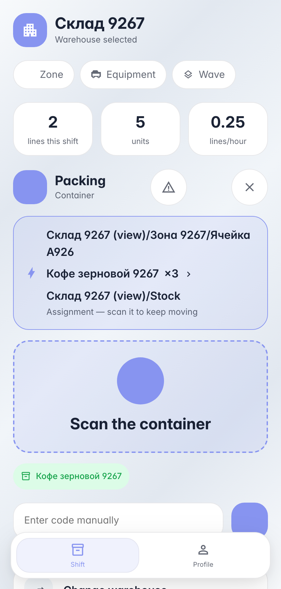

# Packing against an order: product into a box

**Purpose:** the packing leg of an order — picked goods go into a container right on the handheld; the box gets its contents in the system at the same moment as physically.

**Problems solved:** the operation type defines the «pack» flow — the screen asks for product, then container, then quantity; a bin cannot be mistaken for a box — the machine accepts containers only.

**Result:** stock left the bin into the box — the quant now sits on the container.

## Step 1. Scan the product — terminal awaits the box

The «pack» flow is strict: after the product the machine accepts a container only — a bin scan is rejected. The terminal cannot mix up a shelf and a box.

## Step 2. Scan the box — the product is inside

**Result demonstration.** The box card shows the packed coffee — packing hit the ledger; the quant sits on the container.

**Summary.** Packing against an order: scan document → product → box → qty → commit.

