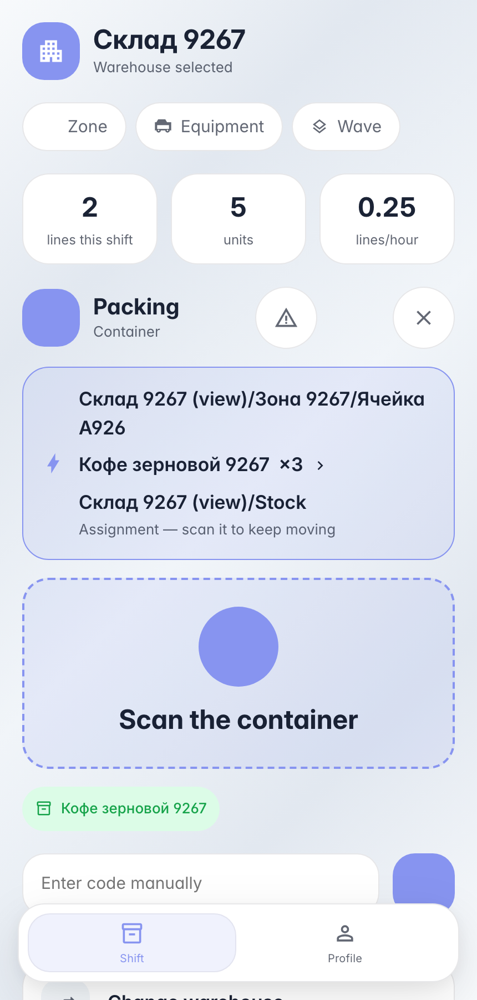

# Упаковка по накладной: товар в короб

**Для чего:** упаковочное плечо накладной — собранный товар раскладывается в тару прямо на терминале, короб получает содержимое в системе одновременно с физическим действием.

**Какие проблемы решает:** тип операции задаёт поток «упаковка» — экран просит товар, затем тару и количество; путать приёмник-ячейку и тару нельзя — машина принимает только контейнер.

**Результат:** товар уехал с ячейки внутрь короба — остаток числится на таре.

## Шаг 1. Скан товара — терминал ждёт тару

Поток «упаковка» ведёт жёстко: после товара машина принимает только контейнер — скан ячейки будет отклонён. Так терминал не даёт перепутать полку с коробом.

## Шаг 2. Скан короба — товар внутри

**Демонстрация результата.** Карточка короба показывает уложенный кофе — упаковка записана леджером, остаток числится на таре.

**Итог.** Упаковка по накладной: скан документа → товар → короб → количество → проводка.

