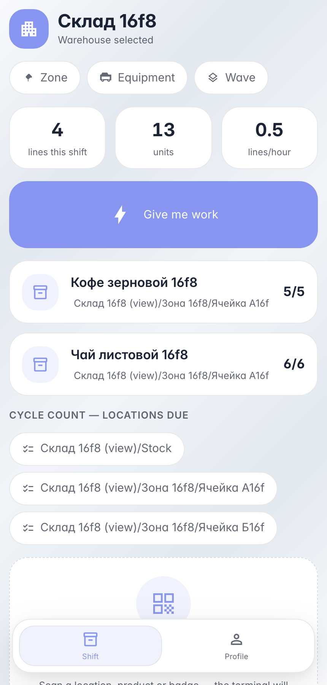
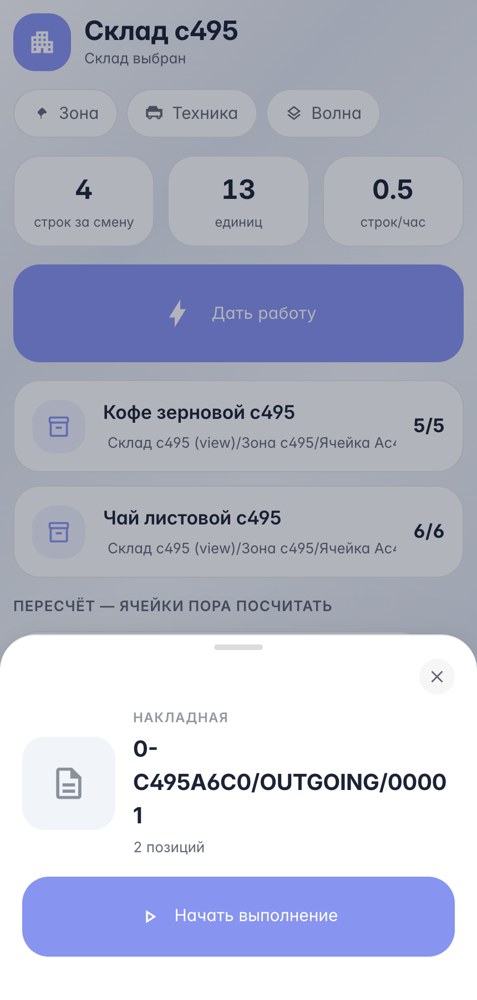
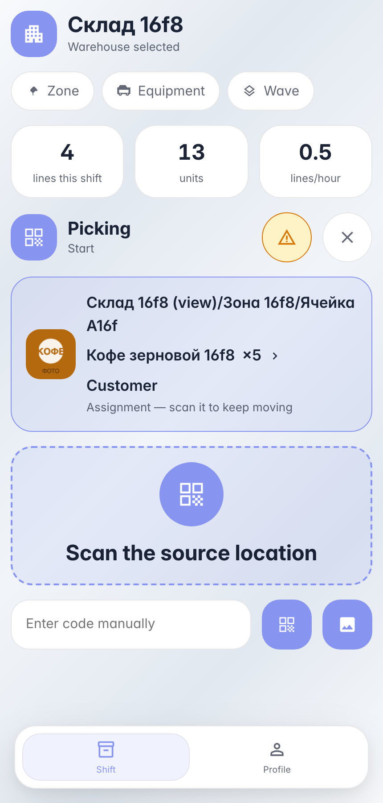
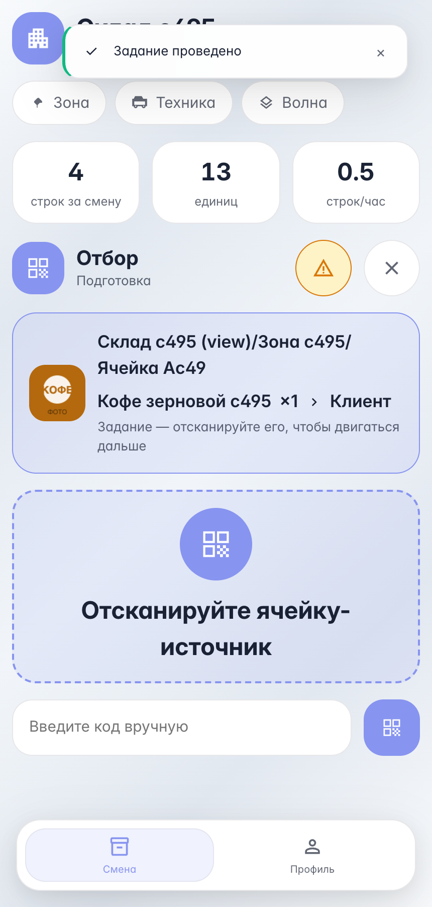
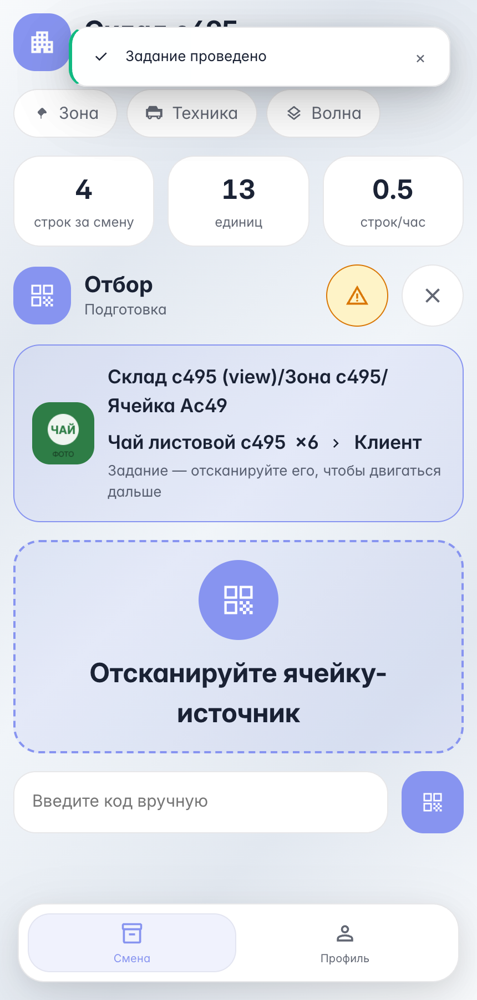
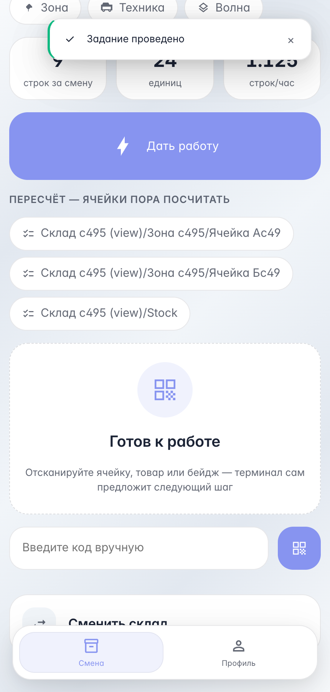
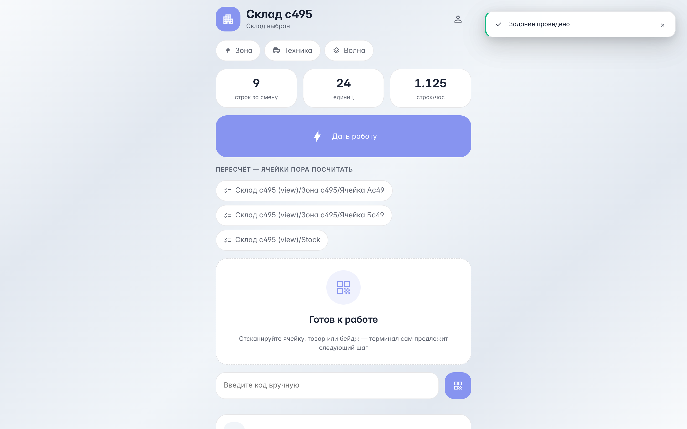

# Working a delivery order: document scan drives the lines

**Purpose:** executing a warehouse document — the operator scans the delivery order barcode; the terminal picks the flow itself and suggests every line.

**Problems solved:** the screen adapts to the document — the backend chooses the «pick» flow from the operation type and shows a «bin → product × qty» hint from the first executable line; the operator needs no printout.

**Result:** both order lines picked and committed, bin stock reduced in the ledger.

## Step 1. Queue — free tasks can be picked manually

The work desk: «give me work» issues the best task automatically, while the queue below lists every executable line — the operator may be physically closer to another bin and can tap it themselves. The release button appears only on lines claimed by them — free lines have nothing to release.

## Step 2. Scan the order — document card

The order barcode resolves to a document: the card shows the number and line count. «Start execution» opens a session — the backend picks the flow itself from the operation type (outgoing → picking).

## Step 3. The terminal suggests the first order line

The «pick» flow was chosen by the backend: the amber strip is a hint from the open document line «bin → product × qty». The operator walks to that bin and scans it — no need to rescan the document.

## Step 4. Terminal reload — session and hint restored

The terminal was reloaded mid-execution — the session restored from storage: the run screen and the amber backend hint are in place, nothing collected is lost. The operator simply keeps scanning.

## Step 5. Partial commit — the terminal suggests the remainder

The document wants 5, the operator carried 4: after the commit the session does NOT close — the backend suggests the next executable line (the ×1 remainder of the same position). No queue round-trip between trips to the same bin.

## Step 6. The document continues — the next line is suggested

The coffee line is done but the order is not: the terminal moves the operator straight to the next executable line (tea) — no queue round-trip and no re-scan of the order. The operator simply walks on.

## Step 7. Order closed — stock matches the document

**Result demonstration.** Both order lines were posted to the ledger: coffee 5 → 0, tea 8 → 2 — exactly per the document specs.

**Summary.** Document work: scan the order → «Start» → line hint → bin → product → qty → commit.

## Step 8. The same terminal on a laptop

The PWA is one bundle for all screens: on desktop the work screen is centered and does not stretch — the queue, shift stats and scan field keep the same layout as on the handheld.

