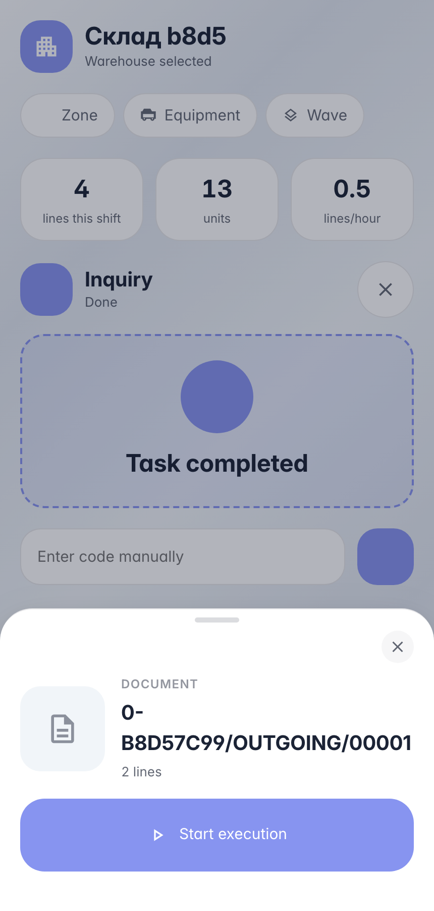
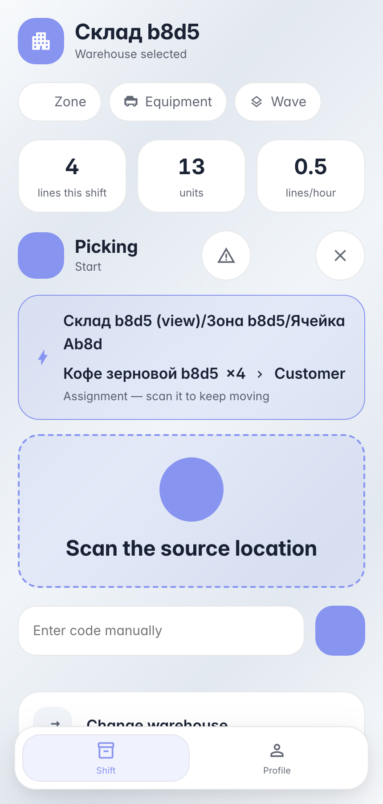
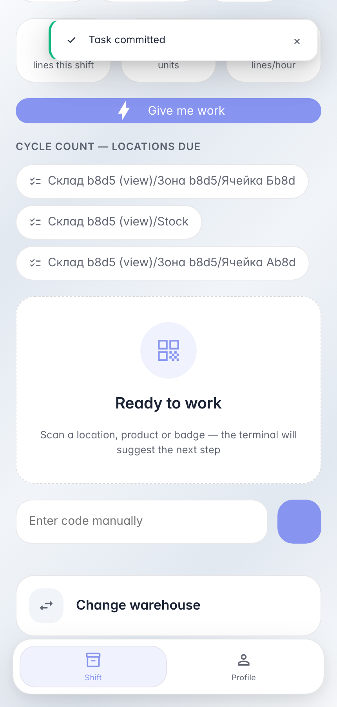

# Working a delivery order: document scan drives the lines

**Purpose:** executing a warehouse document — the operator scans the delivery order barcode; the terminal picks the flow itself and suggests every line.

**Problems solved:** the screen adapts to the document — the backend chooses the «pick» flow from the operation type and shows a «bin → product × qty» hint from the first executable line; the operator needs no printout.

**Result:** both order lines picked and committed, bin stock reduced in the ledger.

## Step 1. Scan the order — document card

The order barcode resolves to a document: the card shows the number and line count. «Start execution» opens a session — the backend picks the flow itself from the operation type (outgoing → picking).

## Step 2. The terminal suggests the first order line

The «pick» flow was chosen by the backend: the amber strip is a hint from the open document line «bin → product × qty». The operator walks to that bin and scans it — no need to rescan the document.

## Step 3. Order closed — stock matches the document

**Result demonstration.** Both order lines were posted to the ledger: coffee 5 → 1, tea 8 → 2 — exactly per the document specs.

**Summary.** Document work: scan the order → «Start» → line hint → bin → product → qty → commit.

