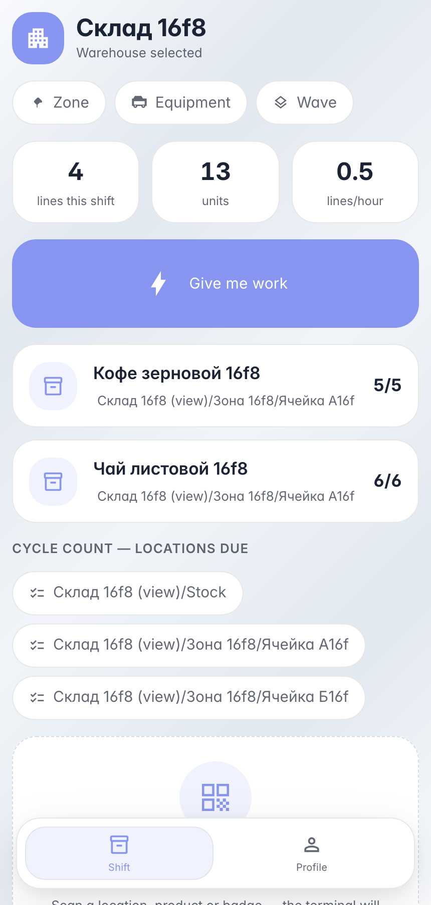
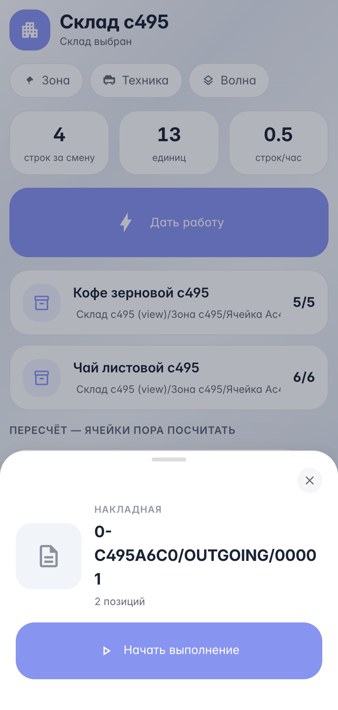
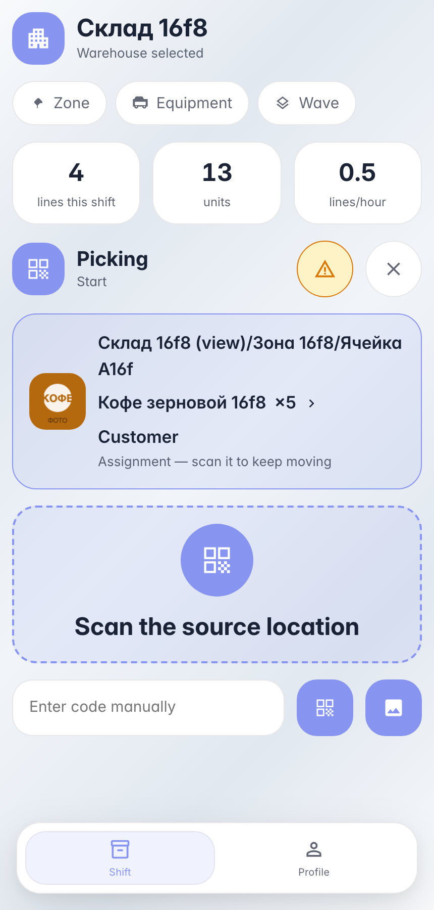
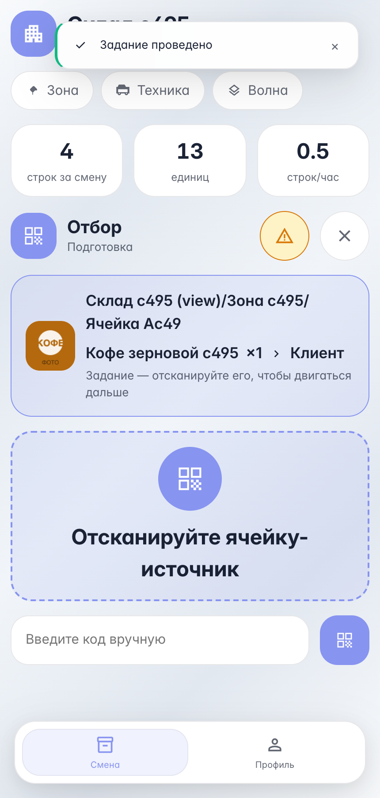
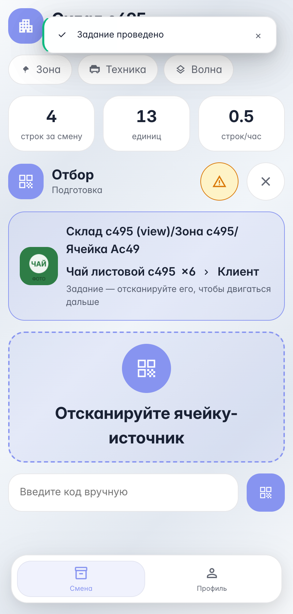
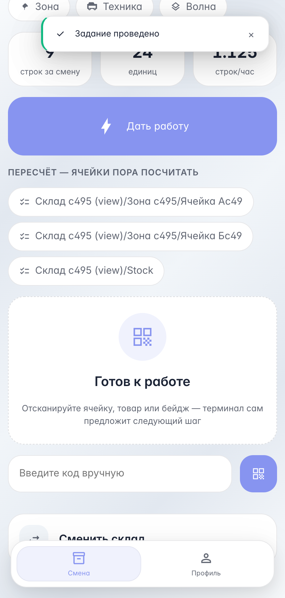
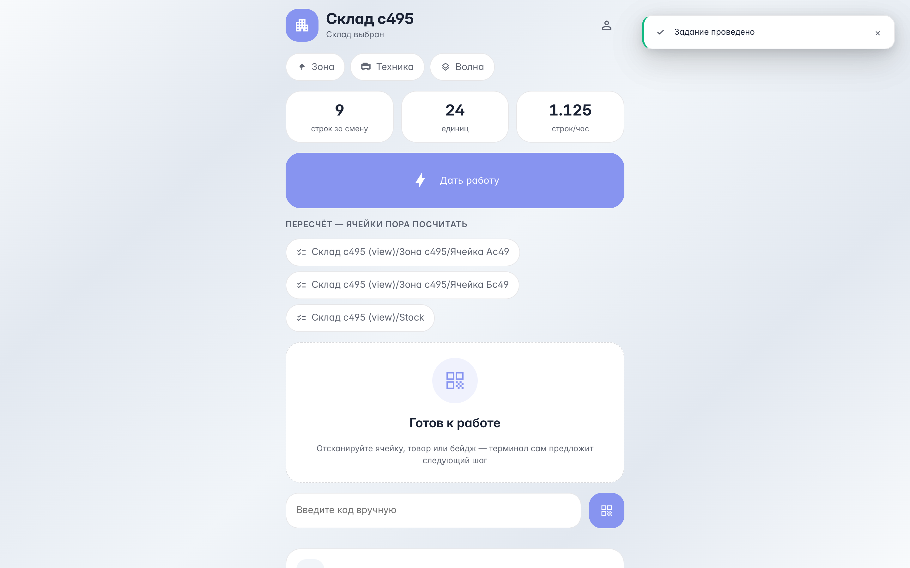

# Работа по накладной: скан документа ведёт по позициям

**Для чего:** исполнение складского документа — оператор сканирует штрихкод накладной на отгрузку, терминал сам выбирает поток и подсказывает каждую позицию.

**Какие проблемы решает:** экран подстраивается под документ — backend выбирает поток «сборка» по типу операции и показывает подсказку «ячейка → товар × количество» из первой исполнимой строки; оператору не нужно знать состав накладной наизусть.

**Результат:** обе позиции накладной собраны и проведены, остатки ячейки уменьшены по леджеру.

## Шаг 1. Очередь — свободные задания можно взять руками

Рабочий стол: «дайте работу» выдаёт лучшее задание автоматически, а очередь ниже показывает все исполнимые строки — оператор физически ближе к другой ячейке и может тапнуть её сам. Кнопка «отпустить» есть только у закреплённых за ним строк — у свободных отпускать нечего.

## Шаг 2. Отсканируйте накладную — карточка документа

Штрихкод накладной резолвится в документ: карточка показывает номер и число позиций. «Начать исполнение» открывает сессию — backend сам выбирает поток по типу операции (отгрузка → сборка).

## Шаг 3. Терминал подсказывает первую позицию накладной

Поток «сборка» выбран backend'ом: жёлтая полоса — подсказка из открытой строки документа «ячейка → товар × количество». Оператор идёт к указанной ячейке и сканирует её — пересканировать накладную не нужно.

## Шаг 4. Перезагрузка терминала — сессия и подсказка на месте

Терминал перезагрузили посреди исполнения — сессия восстановилась из хранилища: экран прогона и жёлтая подсказка backend'а на месте, набранное не потеряно. Оператор просто продолжает сканировать.

## Шаг 5. Коммит части позиции — терминал предлагает добрать остаток

По документу 5 шт, оператор унёс 4: после проводки сессия НЕ закрывается — backend подсказывает следующую исполнимую строку (остаток ×1 той же позиции). Оператор не возвращается в очередь между ходками к одной ячейке.

## Шаг 6. Документ продолжается — следующая позиция уже предложена

Строка кофе закрыта, а накладная — нет: терминал сам переводит оператора на следующую исполнимую позицию документа (чай), без возврата в очередь и повторного скана накладной. Оператор просто идёт дальше.

## Шаг 7. Накладная закрыта — остатки сошлись с документом

**Демонстрация результата.** Обе позиции накладной проведены леджером: кофе 5 → 0, чай 8 → 2 — ровно по спецификациям документа.

**Итог.** Работа по документу: скан накладной → «Начать» → подсказка позиции → ячейка → товар → количество → проводка.

## Шаг 8. Тот же терминал на ноутбуке

PWA — один бандл на все экраны: на десктопе рабочий стол центрирован и не растягивается — очередь, статистика смены и скан-поле остаются в той же компоновке, что на терминале.

