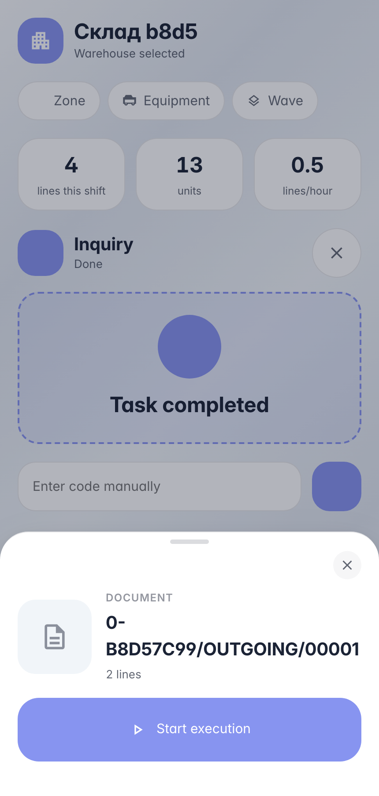
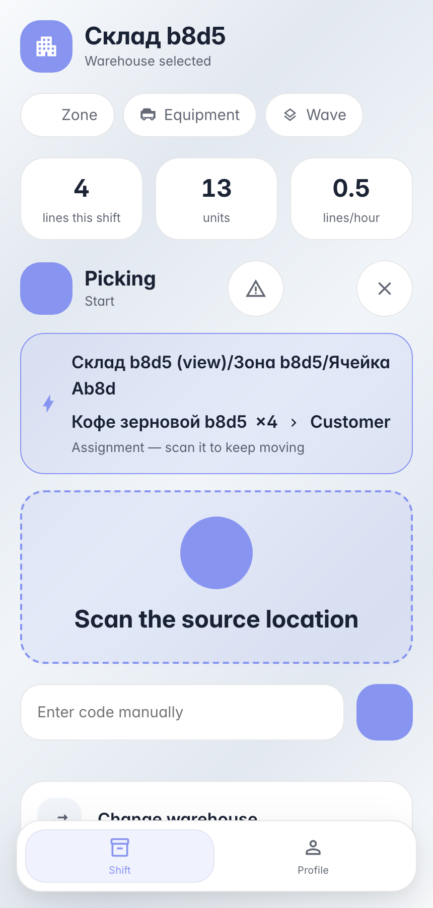
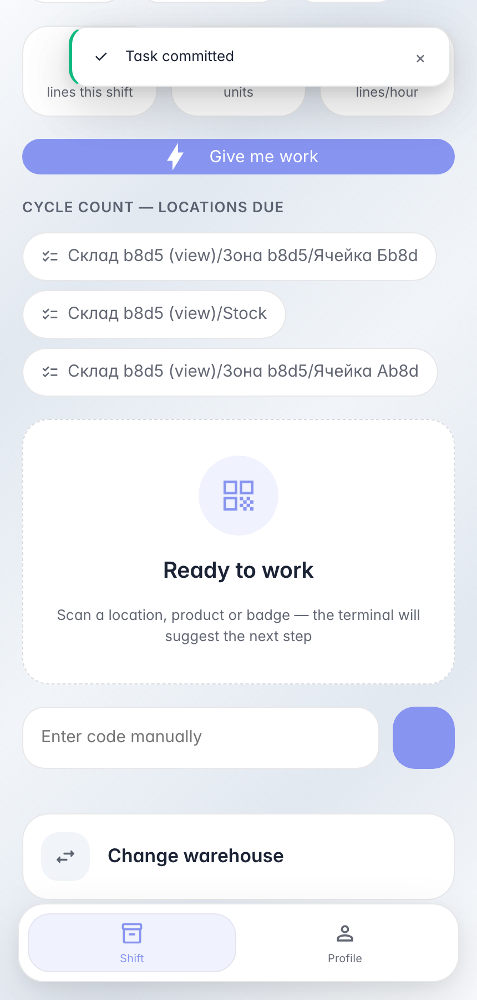

# Работа по накладной: скан документа ведёт по позициям

**Для чего:** исполнение складского документа — оператор сканирует штрихкод накладной на отгрузку, терминал сам выбирает поток и подсказывает каждую позицию.

**Какие проблемы решает:** экран подстраивается под документ — backend выбирает поток «сборка» по типу операции и показывает подсказку «ячейка → товар × количество» из первой исполнимой строки; оператору не нужно знать состав накладной наизусть.

**Результат:** обе позиции накладной собраны и проведены, остатки ячейки уменьшены по леджеру.

## Шаг 1. Отсканируйте накладную — карточка документа

Штрихкод накладной резолвится в документ: карточка показывает номер и число позиций. «Начать исполнение» открывает сессию — backend сам выбирает поток по типу операции (отгрузка → сборка).

## Шаг 2. Терминал подсказывает первую позицию накладной

Поток «сборка» выбран backend'ом: жёлтая полоса — подсказка из открытой строки документа «ячейка → товар × количество». Оператор идёт к указанной ячейке и сканирует её — пересканировать накладную не нужно.

## Шаг 3. Накладная закрыта — остатки сошлись с документом

**Демонстрация результата.** Обе позиции накладной проведены леджером: кофе 5 → 1, чай 8 → 2 — ровно по спецификациям документа.

**Итог.** Работа по документу: скан накладной → «Начать» → подсказка позиции → ячейка → товар → количество → проводка.

