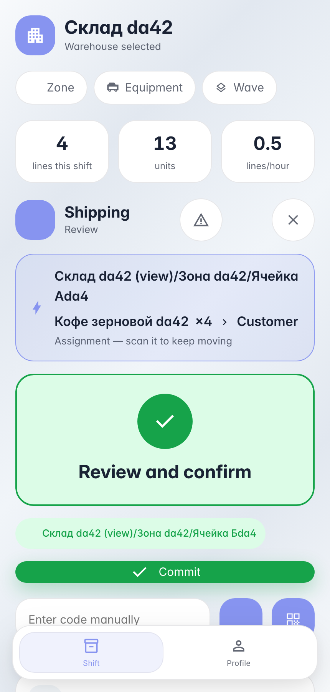
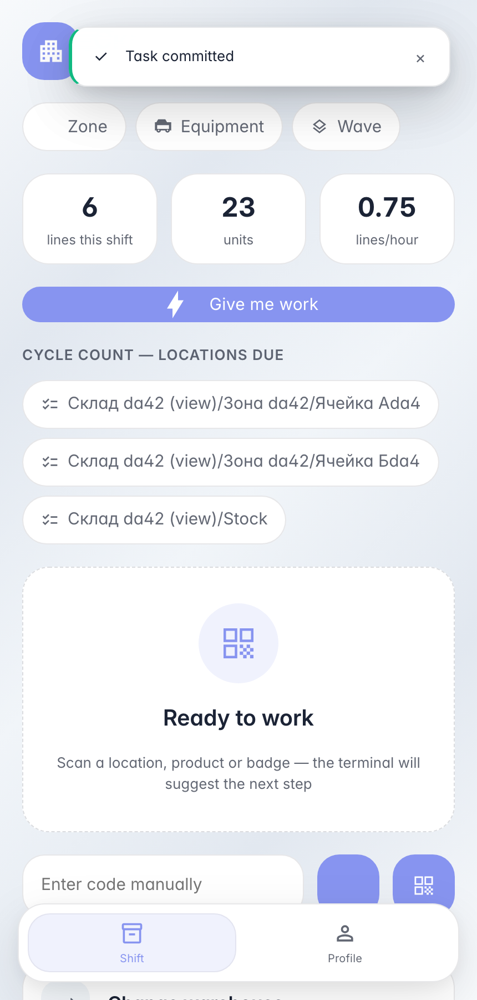

# Shipping an order: one scan closes the leg

**Purpose:** the shipping leg — packed boxes leave by truck; re-scanning every line at the dock is unnecessary.

**Problems solved:** the operation type defines the «ship» flow: scanning the shipping zone confirms the whole leg — all open document lines post in one commit.

**Result:** stock left to the customer per the order, without line-by-line re-scanning.

## Step 1. Scan the shipping zone — the leg is ready

The «ship» flow never asks for lines: one dock/zone scan confirms the shipment — every open leg line posts in a single commit without re-scanning each product. The backend guards the privilege: ship commits only on legs explicitly marked scan_flow=ship.

## Step 2. Order shipped — both lines reconciled

**Result demonstration.** One dock scan closed the whole leg: coffee 5 → 1, tea 8 → 2 — both document lines posted and the order is done.

**Summary.** Shipping: scan the order → scan the dock → commit.

