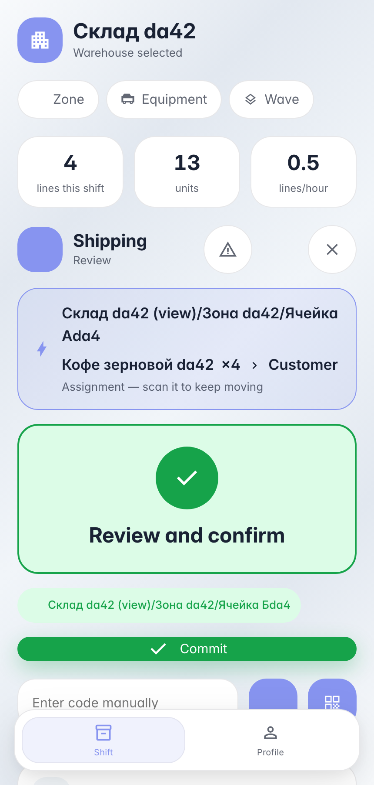
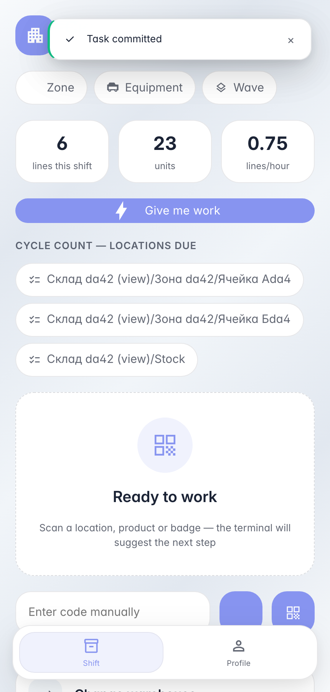

# Отгрузка по накладной: один скан закрывает плечо

**Для чего:** отгрузочное плечо — упакованные короба уезжают машиной; пересканировать каждую позицию на воротах не нужно.

**Какие проблемы решает:** тип операции задаёт поток «отгрузка»: скан отгрузочной зоны подтверждает плечо целиком — все открытые строки документа проводятся одним коммитом.

**Результат:** остатки уехали клиенту по накладной без построчного пересканирования.

## Шаг 1. Скан отгрузочной зоны — плечо готово к проводке

Поток «отгрузка» не спрашивает позиции: один скан ворот/зоны подтверждает факт отгрузки — все открытые строки плеча уйдут одним коммитом без пересканирования каждого товара. Backend держит привилегию: провести ship можно только на плече с явным scan_flow=ship.

## Шаг 2. Накладная отгружена — обе позиции сошлись

**Демонстрация результата.** Один скан отгрузочной закрыл всё плечо: кофе 5 → 1, чай 8 → 2 — обе строки документа проведены и накладная done.

**Итог.** Отгрузка: скан накладной → скан ворот → проводка.

