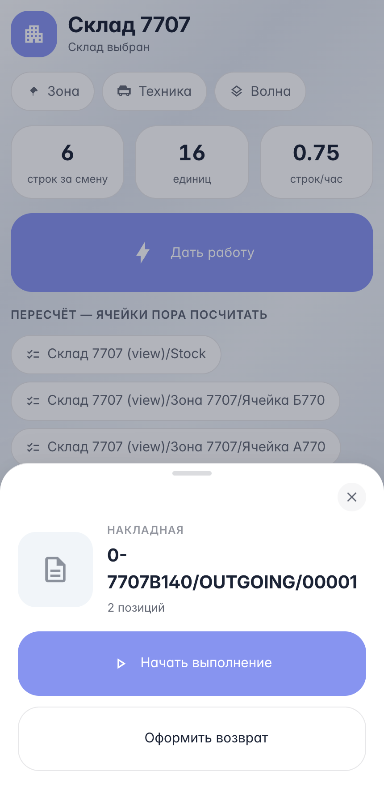
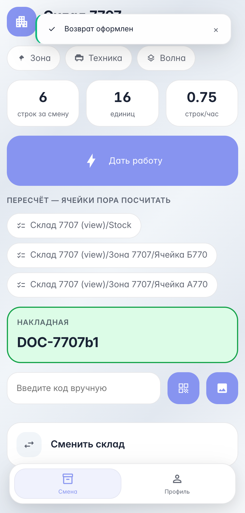
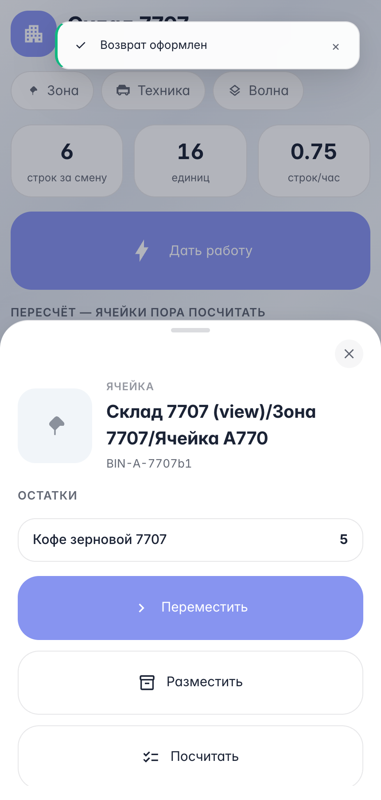

# Customer return: reverse order and receiving

**Purpose:** a customer returned goods — the warehouse needs a reverse document and physical receiving on the handheld so units land back on stock.

**Problems solved:** the «Return» button on the completed order card creates the reverse document itself — no retyping numbers, lines or quantities; the terminal opens receiving for it immediately.

**Result:** a return was created from the shipped order, both lines received back into bins, stock restored.

## Step 1. Scan the completed order

The completed order card shows a «Return» button — the customer brought goods back and the warehouse receives them along the same lines.

## Step 2. Tap «Return» — the document is posted

A return is a fact, not a request: the customer already brought the goods, so the reverse order is created and posted with one tap — lines and stock roll back at once.

## Step 3. Scan the bin — stock restored

**Result demonstration.** The bin shows the original stock — returned units landed back, the return document is posted.

**Summary.** A return is processed on the handheld in one tap: scan the order → «Return» — stock matches reality.

