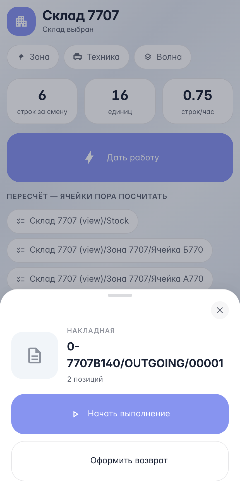
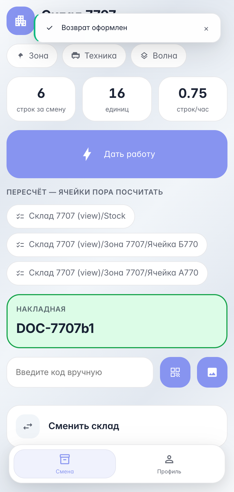
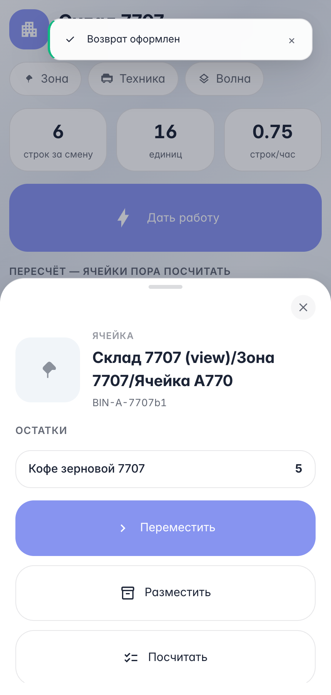

# Возврат от покупателя: обратная накладная и приёмка

**Для чего:** покупатель вернул товар — складу нужен обратный документ и физическая приёмка возврата на терминале, чтобы единицы вернулись на остатки.

**Какие проблемы решает:** кнопка «Возврат» на карточке исполненной накладной создаёт обратный документ сама — номера, строки и количества переписывать не нужно; терминал сразу открывает приёмку по нему.

**Результат:** по отгруженной накладной создан возврат, обе позиции приняты обратно на ячейки, остатки восстановлены.

## Шаг 1. Отсканируйте исполненную накладную

Карточка исполненной накладной показывает кнопку «Возврат» — покупатель привёз товар обратно, и склад оформляет приём по тем же строкам.

## Шаг 2. Нажмите «Возврат» — документ проведён

Возврат — это факт, а не заявка: покупатель уже привёз товар, поэтому обратная накладная создаётся и проводится одним нажатием — строки и остатки откатываются сразу.

## Шаг 3. Отсканируйте ячейку — остаток восстановлен

**Демонстрация результата.** Ячейка показывает первоначальный остаток — возвращённые единицы легли обратно, возвратный документ проведён.

**Итог.** Возврат оформляется с терминала в одно касание: скан накладной → «Возврат» — остатки совпадают с фактом.

